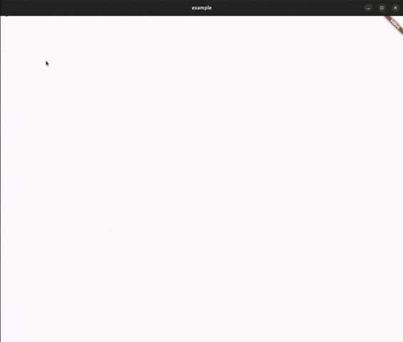
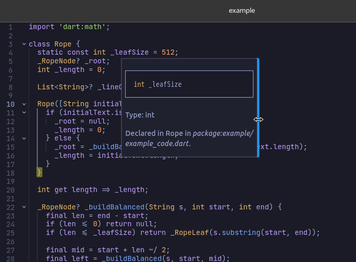

<p align="left">
  <a href="./README.md">English</a> |
  <a href="./README.zh-CN.md">简体中文</a> |
  <a href="./README.es.md">Español</a>
</p>

<h1 align="center">CodeForge</h1>

<p align="center">
  <strong>Un potente widget editor de código repleto de funciones.</strong>
</p>

<p align="center">
  <em>Lleva una experiencia de edición al nivel de VS Code a tus aplicaciones Flutter</em>
</p>

<p align="center">
  Una alternativa completa y superior a <a href="https://pub.dev/packages/re_editor">re_editor</a>, <a href="https://pub.dev/packages/flutter_code_crafter">flutter_code_crafter</a>, <a href="https://pub.dev/packages/flutter_code_editor">flutter_code_editor</a>, <a href="https://pub.dev/packages/code_text_field">code_text_field</a>, etc.
</p>

<p align="center">
  <a href="https://pub.dev/packages/code_forge">
    
  </a>
  <a href="https://github.com/heckmon/code_forge/blob/main/LICENSE">
    
  </a>
  <a href="https://github.com/heckmon/code_forge/stargazers">
    
  </a>
  <a href="https://flutter.dev">
    
  </a>
</p>

---

<p align="center">
  <sub><br>Edición fluida en más de 1 millón de líneas de código, probada en un PC antiguo de gama baja con CPU Pentium de doble núcleo y sin tarjeta gráfica dedicada.</sub>
</p>
<p align="center">
  <sub><br>Resaltado diferido inteligente basado en LSP en más de 100k líneas</sub>
</p>

### Demos de funciones: [Exhibición de funciones de CodeForge](https://heckmon.github.io/code_forge_demo/)

> [!NOTE]
>
> Para compilaciones web, usa el indicador `--wasm` para obtener un mejor rendimiento.
> Ej.:
>```
>flutter build web --wasm
>```

## Novedades en 12.0.0:

### Cambios en la API

Para reducir la complejidad, los parámetros relacionados del widget `CodeForge` ahora se agrupan en dos clases.

- Todos los indicadores booleanos están en `CodeForgeFeatures`, pasados mediante el parámetro `codeForgeFeatures`.
- Todas las opciones de estilo están en `CodeForgeStyling`, pasadas mediante el parámetro `codeForgeStyling`.

```ts
// ej.:
CodeForge(
  codeForgeFeatures: const CodeForgeFeatures(
    autoFocus: true,
    lineWrap: false,
  ),
  codeForgeStyling: CodeForgeStyling(
    textStyle: GoogleFonts.jetBrainsMono(),
    bracketPairStyle: BracketPairStyle(
      style: PaintingStyle.fill,
      color: Colors.yellow.withAlpha(100),
    ),
    matchedWordStyle: const MatchedWordStyle(
      currentMatchStyle: TextStyle(backgroundColor: Color(0xFFFFA726)),
      otherMatchStyle: TextStyle(backgroundColor: Color(0x55FFFF00)),
    ),
  ),
)
```

Dónde se movieron los antiguos parámetros de nivel superior:

| Antiguo (parámetro de nivel superior) | Nueva ubicación |
|---------------------------|--------------|
| `readOnly`, `autoFocus`, `lineWrap`, `enableFolding`, `enableGutter`, `enableGuideLines`, `enableGutterDivider`, `enableKeyboardSuggestions`, `deleteFoldRangeOnDeletingFirstLine` | `codeForgeFeatures` |
| `textStyle`, `ghostTextStyle`, `selectionStyle`, `gutterStyle`, `suggestionStyle`, `hoverDetailsStyle`, `matchHighlightStyle`, `minimapStyle` | `codeForgeStyling` |

### Novedades en la API

- `backgroundOpacity` (0 - 255) permite que el fondo del editor sea parcial o totalmente transparente.
- Panel flotante (hover) redimensionable, con `controller.hoverPanelWidth` y `controller.hoverPanelHeight` para leer o establecer su tamaño.
  <p align="left">
    
  </p>
- Emparejamiento de llaves/paréntesis (`CodeForgeFeatures.enableBracketPairMatching`, `BracketPairStyle`).
- Constructor `CodeForge.plainTextField`, un reemplazo directo para `TextField` sin funciones de IDE.

### Correcciones

- Problema de cierre de pares en citas de bloque.
- [#120](https://github.com/heckmon/code_forge/issues/120)

## ¿Por qué CodeForge?

**CodeForge** es un widget editor de código de nueva generación diseñado para desarrolladores que exigen más. Ya sea que estés construyendo un IDE, un visor de fragmentos de código o una plataforma educativa de programación, CodeForge ofrece:

| Característica | CodeForge | Otros |
|---------|:---------:|:------:|
| Resaltado de sintaxis | 180+ lenguajes<br>[Lenguajes disponibles](https://github.com/reqable/re-highlight/tree/main/lib/languages) | Sí |
| Plegado de código | Detección inteligente | Limitado |
| Multicursor | Sin límite <br> (Alt + Clic) | No |
| Integración con LSP | Soporte completo | No |
| Guías de sangría | Guías estilo VS Code | No |
| Soporte RTL | Para idiomas como el árabe | No |
| Interfaz Git diff | Muestra adiciones y eliminaciones | No |
| Autocompletado con IA | Soporte de texto fantasma (Ghost Text) | No |
| Diagnósticos | Errores en línea | No |
| Deshacer/Rehacer | Agrupación inteligente | Básico |
| Temas completos | [Temas disponibles](https://github.com/reqable/re-highlight/tree/main/lib/styles) | Limitado |


### Qué diferencia a CodeForge de otros editores:
- Utiliza la estructura de datos *rope* en lugar de un arreglo de caracteres convencional para manejar textos grandes.
- Utiliza `RenderBox` y `ParagraphBuilder` de bajo nivel de Flutter para renderizar texto en lugar de `TextField`, logrando mayor eficiencia.
- Cliente [Language Server Protocol](https://microsoft.github.io/language-server-protocol/) integrado.

---

Para ver ejemplos en funcionamiento de todas las funciones de CodeForge, incluyendo autocompletado de código con IA, integración LSP, plegado inteligente de código, resaltado de sintaxis, búsqueda y reemplazo, y soporte para idiomas RTL, visita la página de exhibición de funciones arriba.

### Más funciones

<details>
<summary><strong>Lista completa de funciones</strong></summary>

#### Núcleo del editor
- **Estructura de datos Rope** - Optimizada para archivos grandes
- **180+ lenguajes** - A través del paquete `re_highlight`
- **Lenguajes y temas personalizados** - `CustomLanguageGrammar` (gramática TextMate a modo de resaltado) y `CustomTheme`
- **Plegado de código** - Detección inteligente de bloques
- **Guías de sangría** - Estructura visual del código
- **Minimapa** - Minimapa al estilo de VS Code que refleja el editor
- **Emparejamiento de corchetes/llaves** - Resalta el delimitador coincidente
- **Números de línea** - Con resaltado de línea activa, o contenido personalizado en el margen mediante `GutterBuilder`
- **Deshacer/Rehacer inteligente** - Agrupación basada en marcas de tiempo
- **Buscar y reemplazar** - Barra de búsqueda, barra de reemplazo, resaltado de coincidencias y buscador personalizado con `finderBuilder`
- **Operaciones de línea** - Mover, duplicar y eliminar líneas
- **Multicursor** - Alt + Clic, Alt + Shift + Arriba/Abajo y API en el controlador
- **Fragmentos personalizados (Snippets)** - Muestra tus propios fragmentos en el menú emergente de sugerencias
- **Decoraciones Git Diff** - Líneas añadidas, modificadas y eliminadas virtualmente
- **Texto fantasma (Ghost Text)** - Sugerencias en línea estilo IA
- **Soporte RTL** - Dirección de texto y desplazamiento adaptado a RTL
- **Modo campo de texto plano** - `CodeForge.plainTextField`

#### Funciones LSP
- **Autocompletado inteligente** - Sugerencias de código sensibles al contexto con importación automática
- **Documentación flotante (Hover)** - Descripciones emergentes en Markdown enriquecido con información de tipos, en un panel redimensionable
- **Diagnósticos en tiempo real** - Errores y advertencias con correcciones rápidas
- **Resaltado semántico** - Coloreado basado en tokens con modificadores
- **Ayuda de firmas (Signature Help)** - Firmas de funciones y sugerencias de parámetros
- **Acciones de código (Code Actions)** - Correcciones rápidas y sugerencias de refactorización
- **Pistas en línea (Inlay Hints)** - Anotaciones en línea para tipos y parámetros
- **Resaltado de documento** - Resalta apariciones de símbolos
- **Colores del documento** - Detección de valores de color y selector
- **Ir a la definición** - Navega a las definiciones de símbolos
- **Renombrado de símbolos** - Renombra símbolos en todo el espacio de trabajo
- **Múltiples protocolos** - Soporte para Stdio y WebSocket
- **Control de capacidades** - Habilita o deshabilita selectivamente funciones LSP

#### Personalización
- **Temas completos** - Cada elemento es personalizable
- **Estilo del margen (Gutter)** - Colores, iconos y tamaños
- **Estilo de selección** - Cursor, selección y burbujas
- **Estilo de ventanas emergentes** - Sugerencias y detalles al pasar el cursor
- **Estilo de la barra de desplazamiento** - Forma, color e indicador de línea
- **Estilo del minimapa** - Ancho, colores, tamaño de fuente y altura de línea
- **Atajos de teclado** - Reasigna la mayoría de los atajos con `CodeForgeKeyboardShortcuts`

</details>

---

## Instalación

- 1 . Agrega CodeForge a tu `pubspec.yaml`:

```yaml
dependencies:
  code_forge: ^12.0.0
```
- 2 . Luego ejecuta:

```bash
flutter pub get
```

---

## Inicio rápido

### Uso básico

Importa un tema y un lenguaje desde el paquete [re_highlight](https://pub.dev/packages/re_highlight) y estarás listo. Sin ellos, el editor usa texto plano y `lightfairTheme` por defecto:

```dart
import 'package:flutter/material.dart';
import 'package:code_forge/code_forge.dart';
import 'package:re_highlight/languages/python.dart';
import 'package:re_highlight/styles/atom-one-dark.dart';

void main() => runApp(const MyApp());

class MyApp extends StatelessWidget {
  const MyApp({super.key});

  @override
  Widget build(BuildContext context) {
    return MaterialApp(
      home: Scaffold(
        body: CodeForge(
          language: langPython, // Por defecto: texto plano
          editorTheme: atomOneDarkTheme, // Por defecto: lightfairTheme
        ),
      ),
    );
  }
}
```

### Con controlador

Para mayor control sobre el editor:

```dart
class _EditorState extends State<Editor> {
  final _controller = CodeForgeController();
  final _undoController = UndoRedoController();

  @override
  void dispose() {
    _controller.dispose();
    super.dispose();
  }

  @override
  Widget build(BuildContext context) {
    return CodeForge(
      controller: _controller, // Controlador opcional para más funciones.
      undoController: _undoController, // Controlador opcional para gestionar deshacer y rehacer.
      initialText: 'print("Hello, World!")', // Contenido inicial opcional.
    );
  }
}
```

En lugar de `initialText`, puedes cargar contenido desde un archivo con `filePath`, o desde una URL con `fileUrl`. `fileUrl` no se puede combinar con `initialText`.

### Funciones y estilos

```dart
CodeForge(
  controller: _controller,
  language: langDart,
  editorTheme: atomOneDarkTheme,
  codeForgeFeatures: const CodeForgeFeatures(
    lineWrap: true,
    enableMinimap: false,
    useSpaceAsTab: true,
  ),
  codeForgeStyling: CodeForgeStyling(
    textStyle: const TextStyle(fontSize: 14, fontFamily: 'monospace'),
  ),
)
```

### Campo de texto plano

Usa `CodeForge.plainTextField` como una alternativa más capaz a `TextField`. Desactiva por defecto el margen de números de línea, las guías de sangría, el plegado, el minimapa y el emparejamiento de llaves.

```dart
CodeForge.plainTextField(
  controller: _controller,
  initialText: 'Just some text',
)
```

---

### Compilaciones Web

CodeForge es compatible directamente con compilaciones web de Flutter. Las aplicaciones web no pueden acceder a rutas del sistema de archivos local, así que usa `fileUrl` en lugar de `filePath` al cargar un documento en el navegador:

```dart
CodeForge(
  fileUrl: '[https://example.com/files/main.dart](https://example.com/files/main.dart)',
  controller: controller,
)
```

`fileUrl` es una URL directa cuyo contenido es descargado por el editor. Es importante proporcionarla en compilaciones web porque `filePath` no está disponible en el navegador. `controller.openFile`, `controller.saveFile()` y `controller.refetchFile()` no son compatibles en web.

Si las funciones LSP están habilitadas, proporciona también un URI de documento mediante la configuración LSP (o `fileUri`) para que el servidor de lenguaje pueda identificar el documento virtual. Un navegador no puede iniciar un proceso LSP por stdio; usa `LspSocketConfig` con un servidor LSP expuesto mediante WebSocket:

```dart
final controller = CodeForgeController(
  lspConfig: LspSocketConfig(
    workspacePath: 'file:///workspace',
    languageId: 'dart',
    serverUrl: 'ws://localhost:9000',
  ),
);

CodeForge(
  controller: controller,
  fileUrl: '[https://raw.githubusercontent.com/heckmon/code_forge/main/lib/code_forge/controller.dart](https://raw.githubusercontent.com/heckmon/code_forge/main/lib/code_forge/controller.dart)',
)
```

El servidor WebSocket se puede alojar con [`lsp-ws-proxy`](https://github.com/qualified/lsp-ws-proxy), por ejemplo:

```bash
./lsp-ws-proxy --listen 0.0.0.0:9000 -- dart language-server --protocol=lsp
```

<details>

<summary><h2>Integración con LSP</h2></summary>

Conéctate a cualquier servidor compatible con Language Server Protocol para obtener asistencia inteligente de código.

CodeForge incluye un cliente LSP integrado que te permite conectarte a cualquier servidor LSP para resaltado inteligente, autocompletado, detalles al pasar el cursor, diagnósticos y mucho más.

## Tipos
#### Hay dos formas de configurar el cliente LSP en `CodeForge`:
1. Usando WebSocket (fácil y recomendado)
2. Usando stdio

<details>
<summary><h3>1. Usando WebSocket</h3></summary>

La clase `LspSocketConfig` se utiliza para conectarse a un servidor LSP mediante WebSocket. Recibe los siguientes parámetros:
- `serverUrl`: La URL WebSocket del servidor LSP.
- `filePath`: El servidor LSP requiere un `filePath` para proporcionar autocompletado y diagnósticos.
- `workspacePath`: La ruta del espacio de trabajo es el directorio actual o el directorio padre que contiene el archivo `filePath`.
- `languageId`: Parámetro específico del servidor. Ej.: `'python'` es el ID de lenguaje usado en el servidor de lenguaje basedpyright/pyright.
- `enableDebugLogging`: Desactivado por defecto. Actívalo para imprimir la salida del servidor LSP en la consola.
- `capabilities`: [`LspClientCapabilities`](#lspclientcapabilities) opcional para habilitar o deshabilitar funciones LSP individuales.

Puedes iniciar fácilmente cualquier servidor de lenguaje mediante WebSocket usando el paquete [lsp-ws-proxy](https://github.com/qualified/lsp-ws-proxy). Por ejemplo, para iniciar el servidor de lenguaje basedpyright, usa el siguiente comando:<br>
(En Android puedes usar [Termux](https://github.com/termux/termux-app))

```bash
cd /Downloads/lsp-ws-proxy_linux # Navega al directorio donde se encuentra lsp-ws-proxy

./lsp-ws-proxy --listen 5656 -- basedpyright-langserver --stdio # Inicia el servidor de lenguaje pyright en el puerto 5656
```

#### Ejemplo:
Crea un objeto `LspSocketConfig` y pásalo a `CodeForgeController`.

```dart
final lspConfig = LspSocketConfig(
  workspacePath: "/home/athul/Projects/lsp",
  languageId: "python",
  serverUrl: "ws://localhost:5656",
);
```
Luego pasa la instancia de `lspConfig` a `CodeForgeController` y el controlador al widget `CodeForge`:

```dart
final _controller = CodeForgeController(
  lspConfig: lspConfig, // Pasa aquí el LspConfig.
);

CodeForge(
  controller: _controller, // Pasa aquí el controlador.
  editorTheme: anOldHopeTheme,
  filePath: "/home/athul/Projects/lsp/example.py",
)
```
</details>

<details>
<summary><h3>2. Usando Stdio</h3></summary>

Este método es fácil de iniciar —no requiere configuración de terminal ni paquetes adicionales—, aunque exige un poco más de configuración en tu código. El método `LspStdioConfig.start()` se conecta a un servidor LSP mediante stdio y es asíncrono, por lo que normalmente usarás un `FutureBuilder` para manejar la inicialización. Acepta los siguientes parámetros:
- `executable`: Ubicación del archivo ejecutable del servidor LSP.
- `args`: Argumentos que se pasan al ejecutable del servidor LSP.
- `filePath`: El servidor LSP requiere un `filePath` para proporcionar autocompletado y diagnósticos.
- `workspacePath`: La ruta del espacio de trabajo es el directorio actual o el directorio padre que contiene el archivo `filePath`.
- `languageId`: Parámetro específico del servidor. Ej.: `'python'` es el ID de lenguaje usado en el servidor de lenguaje pyright.
- `enableDebugLogging`: Desactivado por defecto. Actívalo para imprimir la salida del servidor LSP en la consola.
- `capabilities`: [`LspClientCapabilities`](#lspclientcapabilities) opcional para habilitar o deshabilitar funciones LSP individuales.

Para obtener la ruta de `executable`, puedes usar el comando `which` en la terminal. Por ejemplo, para obtener la ruta de `basedpyright-langserver`:

```bash
which basedpyright-langserver
```

#### Ejemplo:
Crea un método asíncrono para inicializar la configuración LSP.
```dart
Future<LspConfig?> _initLsp() async {
  try {
    final config = await LspStdioConfig.start(
      executable: '/home/athul/.nvm/versions/node/v20.19.2/bin/basedpyright-langserver',
      args: ['--stdio'],
      workspacePath: '/home/athul/Projects/lsp',
      languageId: 'python',
    );

    return config;
  } catch (e) {
    debugPrint('LSP Initialization failed: $e');
    return null;
  }
}
```
Luego usa un `FutureBuilder` para inicializar la configuración LSP y pasarla a `CodeForgeController`:
```dart
@override
Widget build(BuildContext context) {
  return MaterialApp(
    home: Scaffold(
      body: SafeArea(
        child: FutureBuilder(
          future: _initLsp(), // Llama al método asíncrono para obtener la configuración LSP.
          builder: (context, snapshot) {
            if (snapshot.connectionState == ConnectionState.waiting) {
              return const Center(child: CircularProgressIndicator());
            }
            return CodeForge(
              editorTheme: anOldHopeTheme,
              controller: CodeForgeController(
                lspConfig: snapshot.data, // Pasa aquí la configuración.
              ),
              filePath: '/home/athul/Projects/lsp/example.py',
              codeForgeStyling: CodeForgeStyling(
                textStyle: const TextStyle(fontSize: 15, fontFamily: 'monospace'),
              ),
            );
          },
        ),
      ),
    ),
  );
}
```
</details>

<hr style="height: 1px; border: none; border-top: 1px">

### Ejemplo de LSP para Dart usando Stdio

```dart
Future<LspConfig> setupDartLsp() async {
  return await LspStdioConfig.start(
    executable: 'dart',
    args: ['language-server', '--protocol=lsp'],
    workspacePath: '/path/to/your/project',
    languageId: 'dart',
  );
}

// En tu widget
@override
Widget build(BuildContext context) {
  return MaterialApp(
    home: Scaffold(
      body: SafeArea(
        child: FutureBuilder<LspConfig>(
          future: setupDartLsp(),
          builder: (context, snapshot) {
            if (snapshot.connectionState == ConnectionState.waiting) {
              return const CircularProgressIndicator();
            }
            return CodeForge(
              language: langDart,
              codeForgeStyling: CodeForgeStyling(
                textStyle: GoogleFonts.jetBrainsMono(),
              ),
              controller: CodeForgeController(
                lspConfig: snapshot.data,
              ),
              filePath: '/path/to/your/file.dart', // Campo obligatorio
            );
          },
        ),
      ),
    ),
  );
}
```
</details>

---

<details>
<summary><h2>Personalización</h2></summary>

CodeForge ofrece amplias opciones de personalización para cada aspecto del editor. Los indicadores booleanos van en `CodeForgeFeatures` y cada estilo va en `CodeForgeStyling`.

### Tema y estilos

```dart
CodeForge(
  controller: controller,
  language: langDart,

  // Tema del editor (colores de sintaxis)
  editorTheme: vs2015Theme,

  // Opacidad del fondo del editor, 0 - 255
  backgroundOpacity: 255,

  codeForgeStyling: CodeForgeStyling(
    // Estilo de texto
    textStyle: GoogleFonts.jetBrainsMono(fontSize: 14),

    // Estilo del texto fantasma (sugerencias en línea de IA)
    ghostTextStyle: const TextStyle(
      color: Colors.grey,
      fontStyle: FontStyle.italic,
    ),

    // Selección y cursor
    selectionStyle: CodeSelectionStyle(
      cursorColor: Colors.white,
      selectionColor: Colors.blue.withValues(alpha: 0.3),
      cursorBubbleColor: Colors.blue,
    ),

    // Margen izquierdo (números de línea e iconos de plegado)
    gutterStyle: GutterStyle(
      lineNumberStyle: const TextStyle(color: Colors.grey),
      backgroundColor: const Color(0xFF1E1E1E),
      activeLineNumberColor: Colors.white,
      foldedIconColor: Colors.grey,
      unfoldedIconColor: Colors.grey,
      errorLineNumberColor: Colors.red,
      warningLineNumberColor: Colors.orange,
    ),

    // Minimapa
    minimapStyle: const MinimapStyle(
      width: 100,
      backgroundColor: Color(0xFF1E1E1E),
    ),

    // Ventana emergente de sugerencias
    suggestionStyle: SuggestionStyle(
      shape: RoundedRectangleBorder(borderRadius: BorderRadius.circular(8)),
      backgroundColor: const Color(0xFF252526),
      focusColor: Colors.blue.withValues(alpha: 0.3),
      hoverColor: Colors.blue.withValues(alpha: 0.1),
      splashColor: Colors.blue.withValues(alpha: 0.2),
      textStyle: const TextStyle(color: Colors.white),
      elevation: 8,
    ),

    // Documentación flotante (Hover)
    hoverDetailsStyle: HoverDetailsStyle(
      shape: RoundedRectangleBorder(borderRadius: BorderRadius.circular(8)),
      backgroundColor: const Color(0xFF252526),
      focusColor: Colors.blue.withValues(alpha: 0.3),
      hoverColor: Colors.blue.withValues(alpha: 0.1),
      splashColor: Colors.blue.withValues(alpha: 0.2),
      textStyle: const TextStyle(color: Colors.white),
    ),

    // Resaltado de texto coincidente usando controller.findWord() y controller.findRegex()
    matchedWordStyle: const MatchedWordStyle(
      currentMatchStyle: TextStyle(backgroundColor: Color(0xFFFFA726)),
      otherMatchStyle: TextStyle(backgroundColor: Color(0x55FFFF00)),
    ),

    // Estilo del par de corchetes/llaves seleccionado
    bracketPairStyle: BracketPairStyle(
      color: Colors.yellow.withAlpha(100),
      style: PaintingStyle.fill,
    ),
  ),

  // La barra de desplazamiento se configura por separado
  scrollbarDecoration: const ScrollbarDecoration(
    thickness: 15,
    showLineNumberIndicator: true,
  ),
)
```

### Temas y lenguajes personalizados

```dart
// Crea tu propio tema en lugar de usar uno de re_highlight
final myTheme = CustomTheme.create(
  color: Colors.white,
  backgroundColor: const Color(0xFF1E1E1E),
  keyword: const TextStyle(color: Colors.pinkAccent),
  string: const TextStyle(color: Colors.greenAccent),
  comment: const TextStyle(color: Colors.grey, fontStyle: FontStyle.italic),
);

// Convierte una gramática TextMate (cadena JSON) en un Mode de re_highlight
final Mode myLanguage = CustomLanguageGrammar.fromJson(grammarJsonString);

CodeForge(
  editorTheme: myTheme,
  language: myLanguage,
)
```

### Interruptores de funciones

```dart
CodeForge(
  codeForgeFeatures: const CodeForgeFeatures(
    readOnly: false,                  // Modo de solo lectura
    autoFocus: true,                  // Enfoque automático al montar
    lineWrap: false,                  // Ajuste de línea
    enableMinimap: true,              // Minimapa
    enableFolding: true,              // Plegado de código
    enableGuideLines: true,           // Guías de sangría
    enableBracketPairMatching: true,  // Resaltar corchetes/llaves coincidentes
    enableGutter: true,               // Números de línea
    enableGutterDivider: false,       // Línea divisoria del margen
    enableLocalSuggestions: true,     // Sugerencias locales de palabras. False por defecto.
    enableKeyboardSuggestions: true,  // Sugerencias del teclado del sistema operativo
    useSpaceAsTab: false,             // Insertar espacios en lugar del carácter de tabulación
    deleteFoldRangeOnDeletingFirstLine: false,
  ),
)
```

### Contenido personalizado del margen (Gutter)

`GutterBuilder` recibe el número de línea (basado en 1) y el texto de la línea. Devuelve una cadena para reemplazar el número de línea de esa fila, o `null` para mantener el valor predeterminado. Cuando `includeReplacedIndex` es `false`, las líneas reemplazadas no se cuentan en la numeración de las líneas siguientes.

```dart
CodeForge(
  gutterBuilder: GutterBuilder(
    includeReplacedIndex: false,
    builder: (lineNumber, lineText) => lineNumber == 1 ? '[HEADER]' : null,
  ),
)
```

### Fragmentos personalizados y menú contextual

```dart
CodeForge(
  // Los fragmentos se muestran en el menú emergente de sugerencias al escribir.
  // cursorLocations son desplazamientos dentro de `value`. El cursor principal se coloca en el primer
  // desplazamiento y los cursores adicionales en los restantes.
  customCodeSnippets: [
    CustomCodeSnippet(
      label: 'forloop',
      value: 'for (var i = 0; i < ; i++) {\n  \n}',
      cursorLocations: {20, 31},
    ),
  ],

  // Opciones adicionales en el menú de clic derecho
  customContextMenuItems: [
    CustomContextMenu(
      label: 'Go to definition',
      description: 'F12',
      onPress: () => goToDefinition(),
    ),
  ],
)
```

### Atajos de teclado

Sobrescribe solo los atajos que desees cambiar. Las operaciones principales (cortar, copiar, pegar, seleccionar todo, deshacer, rehacer) no se pueden reasignar. Usar el mismo atajo para varias operaciones produce un comportamiento indefinido.

```dart
// Duplicar línea pasa de Ctrl + D a Ctrl + B
CodeForge(
  keyboardShotcuts: const CodeForgeKeyboardShortcuts(
    duplicate: SingleActivator(LogicalKeyboardKey.keyB, control: true),
  ),
)
```

Ten en cuenta que el parámetro se escribe `keyboardShotcuts` en la API actual.

### Filas personalizadas de autocompletado LSP

Usa `lspSuggestionBuilder` para reemplazar el contenido predeterminado de cada fila de autocompletado LSP. El constructor recibe el contexto de compilación, el elemento `LspCompletion` y si la fila está seleccionada actualmente.

```dart
CodeForge(
  lspSuggestionBuilder: (context, suggestion, isSelected) {
    return Row(
      children: [
        Icon(
          Icons.code,
          color: isSelected ? Colors.white : Colors.amber,
        ),
        const SizedBox(width: 8),
        Expanded(child: Text(suggestion.label)),
      ],
    );
  },
)
```

Cuando el constructor es `null`, CodeForge utiliza su fila predeterminada de autocompletado LSP y los iconos de tipo integrados cargados desde las fuentes de iconos declaradas en `pubspec.yaml`. El editor sigue proporcionando el comportamiento de selección, hover, efecto splash y toque alrededor del contenido personalizado.

### Widget de búsqueda personalizado

`finderBuilder` construye tu propia barra de búsqueda. El widget devuelto debe implementar `PreferredSizeWidget`.

```dart
CodeForge(
  findController: findController,
  finderBuilder: (context, findController) => MyFinderBar(findController),
)
```

</details>

---

<details>
<summary><h2>Referencia de API</h2></summary>

### Widget CodeForge

| Propiedad | Tipo | Valor predeterminado | Descripción |
|----------|------|---------|-------------|
| `controller` | `CodeForgeController?` | interno | Controlador de texto y selección |
| `undoController` | `UndoRedoController?` | interno | Controlador del historial de deshacer/rehacer |
| `findController` | `FindController?` | interno | Controlador para gestionar la funcionalidad de búsqueda |
| `codeForgeFeatures` | `CodeForgeFeatures` | `CodeForgeFeatures()` | Todos los indicadores booleanos de funciones |
| `codeForgeStyling` | `CodeForgeStyling` | `CodeForgeStyling()` | Todas las opciones de estilo |
| `editorTheme` | `Map<String, TextStyle>?` | `lightfairTheme` | Tema de colores de sintaxis |
| `language` | `Mode?` | texto plano | Lenguaje para el resaltado de sintaxis |
| `extraLanguages` | `List<Mode>` | `[]` | Gramáticas adicionales registradas en el mismo resaltador, para lenguajes que incrustan otros (por ejemplo, TSX usando XML/HTML) |
| `backgroundOpacity` | `int` | `255` | Opacidad del fondo del editor, de 0 (transparente) a 255 (opaco) |
| `filePath` | `String?` | `null` | Ruta del archivo, usada para cargarlo y para LSP. No disponible en web |
| `fileUri` | `String?` | `null` | URI del documento usado para identificar el archivo ante LSP, incluidos documentos web virtuales |
| `fileUrl` | `String?` | `null` | URL directa usada para cargar el contenido del editor. Úsalo en lugar de `filePath` en web. No se puede usar junto con `initialText` |
| `initialText` | `String?` | `null` | Contenido inicial del editor, usado solo durante la inicialización |
| `focusNode` | `FocusNode?` | interno | Nodo de foco para gestionar el enfoque del teclado |
| `innerPadding` | `EdgeInsets?` | `null` | Relleno interior del área de contenido del editor |
| `verticalScrollController` | `ScrollController?` | interno | Controlador de desplazamiento vertical personalizado |
| `horizontalScrollController` | `ScrollController?` | interno | Controlador de desplazamiento horizontal personalizado |
| `verticalScrollPhysics` | `ScrollPhysics` | `ClampingScrollPhysics()` | Comportamiento de desplazamiento vertical. La física horizontal no se puede cambiar porque el editor usa su propia física compatible con RTL |
| `scrollbarDecoration` | `ScrollbarDecoration?` | `null` | Estilo y comportamiento de la barra de desplazamiento vertical |
| `keyboardShotcuts` | `CodeForgeKeyboardShortcuts` | `CodeForgeKeyboardShortcuts()` | Asignación de atajos de teclado |
| `keyboardType` | `TextInputType` | `TextInputType.multiline` | Tipo de teclado virtual |
| `textDirection` | `TextDirection` | `TextDirection.ltr` | Dirección del texto. Usa `TextDirection.rtl` para árabe, hebreo e idiomas similares |
| `tabSize` | `int?` | `1` con tabulaciones, `2` con `useSpaceAsTab` | Tamaño de tabulación |
| `customCodeSnippets` | `List<CustomCodeSnippet>?` | `null` | Fragmentos personalizados mostrados en el menú emergente de sugerencias |
| `customContextMenuItems` | `List<CustomContextMenu>?` | `null` | Elementos personalizados en el menú contextual (el menú que aparece al hacer clic derecho) |
| `gutterBuilder` | `GutterBuilder?` | `null` | Renderiza contenido personalizado en el margen en lugar de números de línea |
| `lspSuggestionBuilder` | `LspSuggestionBuilder?` | `null` | Construye contenido personalizado para cada fila de autocompletado LSP, incluidos iconos personalizados |
| `finderBuilder` | `PreferredSizeWidget Function(BuildContext, FindController)?` | `null` | Constructor para un widget de búsqueda personalizado |

El constructor `CodeForge.plainTextField` recibe los mismos parámetros, pero su `codeForgeFeatures` predeterminado desactiva el margen, las guías de sangría, el plegado, el minimapa y el emparejamiento de llaves.

### CodeForgeFeatures

| Indicador | Predeterminado | Descripción |
|------|:-------:|-------------|
| `readOnly` | `false` | El usuario no puede modificar el texto |
| `autoFocus` | `false` | Enfoca el editor al montarse |
| `lineWrap` | `false` | Ajusta las líneas largas al borde del editor en lugar de desplazarse horizontalmente |
| `enableMinimap` | `true` | Minimapa estilo VS Code que refleja el editor |
| `enableFolding` | `true` | Plegado de código, con iconos de plegado en el margen |
| `enableGuideLines` | `true` | Guías verticales de sangría |
| `enableBracketPairMatching` | `true` | Resalta el delimitador coincidente cuando el cursor está junto a uno |
| `enableLocalSuggestions` | `false` | Sugerencias locales de palabras sin LSP. Desactivado por defecto porque puede causar retrasos en archivos grandes. Las sugerencias LSP se controlan con `LspClientCapabilities` |
| `enableKeyboardSuggestions` | `true` | Muestra autocompletado en el teclado virtual del sistema operativo |
| `useSpaceAsTab` | `false` | Inserta espacios en lugar del carácter de tabulación |
| `enableGutter` | `true` | Muestra el margen con los números de línea |
| `enableGutterDivider` | `false` | Muestra una línea divisoria entre el margen y el contenido |
| `deleteFoldRangeOnDeletingFirstLine` | `false` | Eliminar la primera línea de un bloque plegado elimina todo el bloque |

### CodeForgeStyling

| Propiedad | Tipo | Descripción |
|----------|------|-------------|
| `textStyle` | `TextStyle?` | Estilo base de texto del contenido del editor |
| `ghostTextStyle` | `TextStyle?` | Estilo del texto fantasma (sugerencias en línea). Por defecto usa el estilo base con opacidad reducida |
| `minimapStyle` | `MinimapStyle?` | Estilo del minimapa |
| `selectionStyle` | `CodeSelectionStyle?` | Estilo del cursor y la selección |
| `gutterStyle` | `GutterStyle?` | Estilo del margen |
| `suggestionStyle` | `SuggestionStyle?` | Estilo de la ventana emergente de sugerencias |
| `hoverDetailsStyle` | `HoverDetailsStyle?` | Estilo de la ventana emergente flotante |
| `matchedWordStyle` | `MatchedWordStyle?` | Estilo de las coincidencias encontradas por `findWord()` y `findRegex()` |
| `bracketPairStyle` | `BracketPairStyle?` | Estilo del par de corchetes/llaves resaltado |

### CodeForgeController

```dart
final controller = CodeForgeController(lspConfig: lspConfig); // lspConfig es opcional

// Texto y documento
controller.text = 'Hello, World!'; // Reemplaza todo el contenido y mueve el cursor al final
String content = controller.text;
int length = controller.length;
int lineCount = controller.lineCount;
String visible = controller.visibleText;          // Texto sin contenido plegado
String line = controller.getLineText(0);
List<String> allLines = controller.lines;
List<String> lines = controller.getLinesRange(0, 10);
int lineIndex = controller.getLineAtOffset(42);
int lineStart = controller.getLineStartOffset(0);
int start = controller.findLineStart(42);
int end = controller.findLineEnd(42);
String lastChar = controller.lastTypedCharacter;
String prefix = controller.getCurrentWordPrefixAt(42);

// Edición
controller.insertText('text', line, character);
controller.insertAtCurrentCursor('text', replaceTypedChar: false);
controller.replaceRange(start, end, 'replacement', preserveOldCursor: false);
controller.backspace();
controller.delete();
controller.duplicateLine();
controller.moveLineUp();
controller.moveLineDown();
controller.indent();
controller.unindent();
controller.readOnly = false;

// Sangría
controller.useSpaceAsTab = true;
controller.tabSize = 4;
String tab = controller.tabSpace;                 // La cadena insertada al pulsar Tab
int detected = controller.detectIndentation();
controller.reindentDocument(newTabSize: 2);

// Selección y portapapeles
controller.selection = const TextSelection(baseOffset: 0, extentOffset: 5);
TextSelection current = controller.selection;
controller.setSelectionSilently(TextSelection.collapsed(offset: 3)); // Sin notificar a los listeners
controller.setSelectionImmediately(TextSelection.collapsed(offset: 3));
controller.selectAll();
controller.copy();
controller.cut();
await controller.paste();

// Archivos (no compatible en web)
controller.openFile = '/path/to/file.dart';       // Setter
String? opened = controller.openedFile;
controller.saveFile();                            // Escribe controller.text en el archivo abierto
controller.refetchFile();                         // Recarga el archivo abierto desde el disco
// controller.fileUri y controller.fileUrl se usan para documentos web

// Plegado
controller.foldAll();
controller.unfoldAll();
controller.toggleFold(lineNumber);                // Basado en cero. Lanza StateError si el plegado está desactivado o no hay rango plegable
bool folded = controller.isLineInFoldedRegion(lineIndex);
int? foldStart = controller.getFoldStartForLine(lineIndex);
FoldRange? range = controller.getFoldRangeAtCurrentLine(lineIndex);
Map<int, FoldRange?> folds = controller.foldings; // También tiene setter
controller.deleteFoldRangeOnDeletingFirstLine = false;

// Desplazamiento
controller.scrollToLine(50);                      // Basado en cero. Despliega bloques si es necesario. Lanza RangeError si está fuera de rango

// Búsqueda
controller.findWord('word', matchCase: false, matchWholeWord: false);
controller.findRegex(RegExp(r'\d+'));
controller.clearSearchHighlights();
controller.searchHighlights; // List<SearchHighlight>, cada uno con start, end e isCurrentMatch

// Multicursor
controller.addMultiCursor(line, character);
controller.clearMultiCursors();
controller.multiCursors;     // List<({int line, int character})>
controller.hasMultiCursors;
controller.moveMultiCursorsLeft(isShiftPressed: false);
controller.moveMultiCursorsRight(isShiftPressed: false);
controller.moveMultiCursorsUp(isShiftPressed: false);
controller.moveMultiCursorsDown(isShiftPressed: false);
controller.insertAtAllCursors('text');
controller.backspaceAtAllCursors();
controller.deleteAtAllCursors();

// Navegación del cursor (todos aceptan isShiftPressed: false para extender la selección)
controller.pressLetfArrowKey();   // Se escribe así en la API actual
controller.pressRightArrowKey();
controller.pressUpArrowKey();
controller.pressDownArrowKey();
controller.pressHomeKey();
controller.pressEndKey();
controller.pressDocumentHomeKey();
controller.pressDocumentEndKey();

// Decoraciones de línea y margen
controller.addLineDecoration(LineDecoration decoration);
controller.addLineDecorations(List<LineDecoration> decorations);
controller.removeLineDecoration('id');
controller.clearLineDecorations();
controller.addGutterDecoration(GutterDecoration decoration);
controller.addGutterDecorations(List<GutterDecoration> decorations);
controller.removeGutterDecoration('id');
controller.clearGutterDecorations();

// Decoraciones Git diff
controller.setGitDiffDecorations(
  addedRanges: [(10, 15)],                                  // (startLine, endLine)
  modifiedRanges: [(20, 22)],
  removedRanges: [(afterLine: 29, content: 'final x = 10;\nfinal y = 20;')], // Se muestra virtualmente, sin números de línea
  addedColor: const Color(0xFF4CAF50),
  removedColor: const Color(0xFFE53935),
  modifiedColor: const Color(0xFF2196F3),
);
controller.clearGitDiffDecorations();

// Texto fantasma (sugerencias en línea)
controller.setGhostText(GhostText(line: 10, column: 15, text: 'print("Hello");'));
controller.clearGhostText();

// Sugerencias y LSP
controller.lspConfig;                             // El LspConfig pasado al constructor
controller.enableLocalSuggestions = true;
controller.showCompletions();                     // Solicita sugerencias en el cursor (Ctrl + Espacio)
controller.acceptSuggestion(selectedIndex: 0);
controller.clearAllSuggestions();                 // Limpia sugerencias, ayuda de firmas y acciones de código
List<dynamic>? suggestions = controller.suggestions; // Elementos LspCompletion, o String para sugerencias locales
List<LspErrors> diagnostics = controller.diagnostics;
await controller.callSignatureHelp();
controller.getCodeAction();
await controller.applyWorkspaceEdit(action);

// Pistas en línea (Inlay hints)
await controller.showInlayHints();                // Obtiene y muestra pistas. También pone el editor en solo lectura mientras estén visibles
controller.hideInlayHints();
controller.setInlayHints(List<InlayHint> hints);
controller.clearInlayHints();
controller.inlayHints;

// Colores y resaltados del documento
await controller.fetchDocumentColors();
controller.setDocumentColors(List<DocumentColor> colors);
controller.clearDocumentColors();
await controller.fetchDocumentHighlights(line, character);
controller.scheduleDocumentHighlightsRefresh(line, character); // Versión con debounce
controller.clearDocumentHighlights();

// Rangos de plegado LSP
await controller.fetchLSPFoldRanges();
controller.clearLSPFoldRanges();

// Tamaño del panel flotante (Hover)
controller.hoverPanelWidth = 400;                 // El getter devuelve null mientras se use el ancho predeterminado
controller.hoverPanelHeight = 300;

// Ciclo de vida
controller.setUndoController(undoController);
controller.addListener(() {});
controller.removeListener(listener);
controller.dispose();
```

La lista completa de métodos está disponible en la [documentación de la API](https://pub.dev/documentation/code_forge/latest/code_forge_controller/CodeForgeController-class.html#instance-methods).

### CodeForgeKeyboardShortcuts

Cada campo es un `ShortcutActivator`. Valores predeterminados:

| Campo | Predeterminado |
|-------|---------|
| `duplicate` | Ctrl + D |
| `shiftLineUp` | Ctrl + Shift + Up |
| `shiftLineDown` | Ctrl + Shift + Down |
| `deletWordBackward` | Ctrl + Backspace |
| `deletWordForward` | Ctrl + Delete |
| `moveCursorToPreviousWord` | Ctrl + Left |
| `moveCursorToNextWord` | Ctrl + Right |
| `moveSelectionToPreviousWord` | Ctrl + Shift + Left |
| `moveSelectionToNextWord` | Ctrl + Shift + Right |
| `moveSelectionBackward` | Shift + Left |
| `moveSelectionForward` | Shift + Right |
| `moveSelectionUpward` | Shift + Up |
| `moveSelectionDownward` | Shift + Down |
| `selectToLineStart` | Shift + Home |
| `selectToLineEnd` | Shift + End |
| `jumpToDocumentStart` | Ctrl + Home |
| `jumpToDocumentEnd` | Ctrl + End |
| `jumpToDocumentStartAndSelectText` | Ctrl + Shift + Home |
| `jumpToDocumentEndAndSelectText` | Ctrl + Shift + End |
| `lspCodeActions` | Ctrl + . |
| `lspSignatureHelp` | Ctrl + Shift + Space |
| `showCompletions` | Ctrl + Space |
| `showFindBar` | Ctrl + F |
| `showFindAndReplaceBar` | Ctrl + H |
| `extendMutliCursorDownward` | Alt + Shift + Down |
| `extendMutliCursorUpward` | Alt + Shift + Up |

El atajo de pistas en línea LSP (Ctrl + Alt) y las operaciones principales (cortar, copiar, pegar, seleccionar todo, deshacer, rehacer) no son modificables.

### CodeSelectionStyle

```dart
CodeSelectionStyle({
  Color? cursorColor,
  Color selectionColor = const Color(0x6E2195F3),
  Color cursorBubbleColor = Colors.blue,
})
```

### GutterStyle

```dart
GutterStyle({
  TextStyle? lineNumberStyle,
  Color? backgroundColor,
  double? gutterWidth,
  IconData foldedIcon = Icons.chevron_right_outlined,
  IconData unfoldedIcon = Icons.keyboard_arrow_down_outlined,
  double? foldingIconSize,
  Color? foldedIconColor,
  Color? unfoldedIconColor,
  Color? activeLineNumberColor,
  Color? inactiveLineNumberColor,
  Color errorLineNumberColor = const Color(0xFFE53935),
  Color warningLineNumberColor = const Color(0xFFFFA726),
  Color? foldedLineHighlightColor,
})
```

### MinimapStyle

```dart
const MinimapStyle({
  double? width,
  Color? backgroundColor,
  Color? overlayColor,
  Color? overlayHoverColor,
  double? overlayBorderRadius,
  double fontSize = 2.5,
  double lineHeight = 3,
})
```

### SuggestionStyle y HoverDetailsStyle

Ambos extienden `OverlayStyle`. `shape`, `backgroundColor`, `focusColor`, `hoverColor`, `splashColor` y `textStyle` son obligatorios, y `elevation` tiene el valor predeterminado `6`.

```dart
SuggestionStyle(
  shape: RoundedRectangleBorder(borderRadius: BorderRadius.circular(8)),
  backgroundColor: Colors.grey[900]!,
  focusColor: Colors.blue.withValues(alpha: 0.3),
  hoverColor: Colors.blue.withValues(alpha: 0.1),
  splashColor: Colors.blue.withValues(alpha: 0.2),
  textStyle: const TextStyle(color: Colors.white),
  // Opcionales, solo en SuggestionStyle:
  selectedBackgroundColor: null,
  borderColor: null,
  borderWidth: null,
  itemHeight: null,
  iconSize: null,
  methodIconColor: null,
  propertyIconColor: null,
  classIconColor: null,
  variableIconColor: null,
  keywordIconColor: null,
  labelTextStyle: null,
  detailTextStyle: null,
  typeTextStyle: null,
)

HoverDetailsStyle(
  shape: RoundedRectangleBorder(borderRadius: BorderRadius.circular(8)),
  backgroundColor: Colors.grey[850]!,
  focusColor: Colors.blue.withValues(alpha: 0.3),
  hoverColor: Colors.blue.withValues(alpha: 0.1),
  splashColor: Colors.blue.withValues(alpha: 0.2),
  textStyle: const TextStyle(color: Colors.white),
)
```

### MatchedWordStyle y BracketPairStyle

```dart
const MatchedWordStyle(
  currentMatchStyle: TextStyle(backgroundColor: Color(0xFFFFA726)),
  otherMatchStyle: TextStyle(backgroundColor: Color(0x55FFFF00)),
)

BracketPairStyle(
  color: Colors.yellow.withAlpha(100), // Por defecto: color del texto
  style: PaintingStyle.fill,           // fill (predeterminado) o stroke
)
```

### ScrollbarDecoration

Configura la barra de desplazamiento vertical.

```dart
const ScrollbarDecoration({
  bool showLineNumberIndicator = true, // Muestra el número de línea actual junto a la barra de desplazamiento
  TextStyle? lineNumberStyle,
  Color? thumbColor,
  double? thickness,
  bool? thumbVisibility,
  BorderRadius borderRadius = BorderRadius.zero,
  double minThumbLength = 18.0,
  double? minOverscrollLength,
  bool? trackVisibility,
  Radius? trackRadius,
  Color? trackColor,
  Color? trackBorderColor,
  Duration fadeDuration = const Duration(milliseconds: 300),
  Duration timeToFade = const Duration(milliseconds: 600),
  Duration pressDuration = Duration.zero,
  ScrollNotificationPredicate notificationPredicate = defaultScrollNotificationPredicate,
  bool? interactive,
  ScrollbarOrientation? scrollbarOrientation,
  double mainAxisMargin = 0.0,
  double crossAxisMargin = 0.0,
  EdgeInsetsGeometry? padding,
})
```

### Modelos de decoración y superposición

```dart
// Decoración de línea: LineDecorationType puede ser background, leftBorder, underline o wavyUnderline
LineDecoration(
  id: 'bookmark-1',            // Obligatorio y único
  startLine: 10,
  endLine: 15,
  type: LineDecorationType.background,
  color: Colors.green.withValues(alpha: 0.2),
  thickness: 3.0,
  priority: 0,
)

// Decoración de margen: GutterDecorationType puede ser colorBar, icon o dot
GutterDecoration(
  id: 'breakpoint-1',          // Obligatorio y único
  startLine: 25,
  endLine: 25,
  type: GutterDecorationType.icon,
  color: Colors.red,
  icon: Icons.circle,
  width: 3.0,
  tooltip: 'Breakpoint',
  priority: 0,
)

// Texto fantasma. Por defecto se limpia al mover el cursor o escribir texto que no coincide, y se acepta con
// Tab o la flecha derecha. Con shouldPersist: true solo clearGhostText() lo elimina
GhostText(line: 10, column: 15, text: 'print("Hello");', style: null, shouldPersist: false)

// Líneas eliminadas mostradas entre líneas reales, sin números de línea
VirtualRemovedBlock(afterLine: 29, content: 'final x = 10;', backgroundColor: Color(0x30E53935))

// Pista en línea, color de documento y resaltado de documento (normalmente creados a partir de respuestas LSP)
InlayHint(line: 3, column: 8, text: 'int', kind: InlayHintKind.type)
DocumentColor(line: 10, startColumn: 15, endColumn: 25, color: Color(0xFFFF0000))
DocumentHighlight(startLine: 4, startColumn: 2, endLine: 4, endColumn: 9)
```

Todos los valores de línea y columna están basados en cero.

### Otras clases

```dart
FoldRange(startIndex, endIndex)                  // Línea inicial y final (basada en cero) de una región plegable
CustomContextMenu(label: '', description: '', onPress: () {})
GutterBuilder(builder: (lineNumber, lineText) => null, includeReplacedIndex: true)
DiagnosticLine(severity: ..., range: ..., message: ...) // Indicador de error (subrayado ondulado), extiende LspErrors
CustomTheme.create(color: ..., backgroundColor: ...)    // Devuelve Map<String, TextStyle>
CustomLanguageGrammar.fromJson(String json)             // Devuelve un Mode de re_highlight
```

### LspClientCapabilities

Controla qué funciones LSP se habilitan durante la inicialización del servidor de lenguaje.

```dart
// Pásalo a LspSocketConfig o LspStdioConfig
final lspConfig = LspSocketConfig(
  workspacePath: "/path/to/workspace",
  languageId: "dart",
  serverUrl: "ws://localhost:5656",
  capabilities: LspClientCapabilities(
    semanticHighlighting: true,  // Resaltado semántico de tokens
    codeCompletion: true,        // Sugerencias de autocompletado
    hoverInfo: true,             // Documentación flotante
    codeAction: true,            // Acciones de código y correcciones rápidas
    signatureHelp: true,         // Ayuda de firmas
    documentColor: true,         // Detección de colores del documento
    documentHighlight: true,     // Resaltado de apariciones de símbolos
    codeFolding: true,           // Rangos de plegado de código
    inlayHint: true,             // Pistas en línea
    goToDefinition: true,        // Ir a la definición
    rename: true,                // Renombrado de símbolos
  ),
);
```

</details>

---
<details>
<summary><h2>Atajos de teclado</h2></summary>
CodeForge admite una variedad de atajos de teclado para una edición eficiente. La mayoría se pueden reasignar con `CodeForgeKeyboardShortcuts`.

### Edición
- **Ctrl+C** - Copiar el texto seleccionado.
- **Ctrl+X** - Cortar el texto seleccionado.
- **Ctrl+V** - Pegar texto.
- **Ctrl+A** - Seleccionar todo el texto.
- **Ctrl+D** - Duplicar la selección, o la línea actual si no hay nada seleccionado.
- **Ctrl+Z** - Deshacer la última acción.
- **Ctrl+Y** - Rehacer la última acción.
- **Ctrl+Backspace** - Eliminar palabra hacia atrás.
- **Ctrl+Delete** - Eliminar palabra hacia adelante.
- **Alt + Clic** - Añadir un cursor (multicursor).
- **Alt+Shift+Flecha Arriba/Abajo** - Extender el multicursor a las líneas superiores o inferiores.

### Navegación
- **Ctrl+Flecha Izquierda** - Mover el cursor a la palabra anterior.
- **Ctrl+Flecha Derecha** - Mover el cursor a la palabra siguiente.
- **Ctrl+Inicio (Home)** - Mover el cursor al principio del documento.
- **Ctrl+Fin (End)** - Mover el cursor al final del documento.
- **Ctrl+Shift+Flecha Arriba** - Mover la línea actual hacia arriba.
- **Ctrl+Shift+Flecha Abajo** - Mover la línea actual hacia abajo.

### Sangría
- **Tab** - Aplicar sangría a la línea actual o aceptar la sugerencia/autocompletado de IA.
- **Shift+Tab** - Quitar sangría a la línea actual.

### Sugerencias y autocompletado con IA
- **Ctrl+Espacio** - Mostrar sugerencias de autocompletado bajo demanda.
- **Ctrl+.** - Mostrar acciones de código LSP disponibles.
- **Ctrl+Shift+Espacio** - Mostrar ayuda de firmas LSP disponible.
- **Ctrl+Alt** - Mostrar pistas en línea LSP (no reasignable).
- **Flecha Arriba/Abajo** - Navegar por las sugerencias.
- **Enter/Tab** - Aceptar la sugerencia actual.
- **Escape** - Cerrar sugerencias o detalles flotantes.

### Selección
- **Shift+Teclas de flecha** - Extender la selección.
- **Ctrl+Shift+Flecha Izquierda/Derecha** - Seleccionar hasta la palabra anterior/siguiente.
- **Shift+Inicio (Home)** - Seleccionar hasta el inicio de la línea.
- **Shift+Fin (End)** - Seleccionar hasta el final de la línea.
- **Ctrl+Shift+Inicio (Home)** - Seleccionar hasta el inicio del documento.
- **Ctrl+Shift+Fin (End)** - Seleccionar hasta el final del documento.

### Búsqueda
- **Ctrl+F** - Mostrar barra de búsqueda.
- **Ctrl+H** - Mostrar barra de reemplazo.

</details>

---

## Usado por

- [Roxum IDE](https://github.com/heckmon/roxum-ide) - Un IDE y editor de código minimalista y potente para Android.
- [Haha Note](https://github.com/catpuppyapp/HahaNote-Release) - Una aplicación de notas de código abierto con soporte para sincronización cifrada de extremo a extremo (E2EE).
- [Proxypin](https://github.com/wanghongenpin/proxypin) - Una herramienta de captura de tráfico HTTP(S) de código abierto con soporte multiplataforma.

  ##### *¿Quieres mostrar tu aplicación aquí? Crea una discusión en [este hilo](https://github.com/heckmon/code_forge/discussions/categories/used-by) con los detalles de tu app.*
---

## Licencia

Este proyecto está bajo la licencia MIT; consulta el archivo [LICENSE](https://github.com/heckmon/code_forge/blob/main/LICENSE) para más detalles.

---

<p align="center">
  <strong>Creado para la comunidad de Flutter</strong>
</p>

<p align="center">
  <a href="https://github.com/heckmon/code_forge">
    
  </a>
</p>