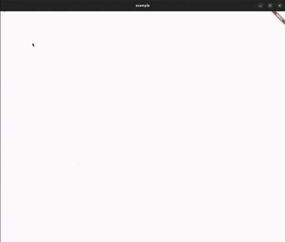
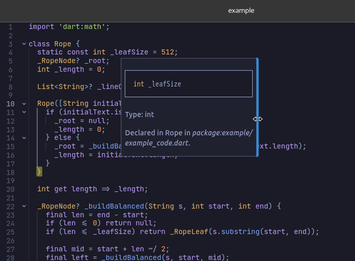

<p align="left">
  <a href="./README.md">English</a> |
  <a href="./README.zh-CN.md">简体中文</a> |
  <a href="./README.es.md">Español</a>
</p>

<h1 align="center">CodeForge</h1>

<p align="center">
  <strong>A powerful, feature-rich code editor widget.</strong>
</p>

<p align="center">
  <em>Bring VS Code-level editing experience to your Flutter apps</em>
</p>

<p align="center">
  A complete and better alternative for <a href="https://pub.dev/packages/re_editor">re_editor</a>, <a href="https://pub.dev/packages/flutter_code_crafter">flutter_code_crafter</a>, <a href="https://pub.dev/packages/flutter_code_editor">flutter_code_editor</a>, <a href="https://pub.dev/packages/code_text_field">code_text_field</a>, etc.
</p>

<p align="center">
  <a href="https://pub.dev/packages/code_forge">
    
  </a>
  <a href="https://github.com/heckmon/code_forge/blob/main/LICENSE">
    
  </a>
  <a href="https://github.com/heckmon/code_forge/stargazers">
    
  </a>
  <a href="https://flutter.dev">
    
  </a>
</p>

---

<p align="center">
  <sub><br>Smooth editing in 1M+ lines of code, tested on a decades old low end PC with pentium dual core CPU and no dedicated graphics card.</sub>
</p>
<p align="center">
  <sub><br>LSP based intelligent lazy highlighting on 100k+ lines</sub>
</p>

### Feature demos: [CodeForge Features Showcase](https://heckmon.github.io/code_forge_demo/)

> [!NOTE]
>
> For the web builds, use the `--wasm` flag for better performance.
> eg:
>```
>flutter build web --wasm
>```

## What's new in 12.0.0:

### API changes

To reduce complexity, related parameters of the `CodeForge` widget are now grouped into two classes.

- All boolean flags live in `CodeForgeFeatures`, passed through the `codeForgeFeatures` parameter.
- All styling options live in `CodeForgeStyling`, passed through the `codeForgeStyling` parameter.

```ts
// eg:
CodeForge(
  codeForgeFeatures: const CodeForgeFeatures(
    autoFocus: true,
    lineWrap: false,
  ),
  codeForgeStyling: CodeForgeStyling(
    textStyle: GoogleFonts.jetBrainsMono(),
    bracketPairStyle: BracketPairStyle(
      style: PaintingStyle.fill,
      color: Colors.yellow.withAlpha(100),
    ),
    matchedWordStyle: const MatchedWordStyle(
      currentMatchStyle: TextStyle(backgroundColor: Color(0xFFFFA726)),
      otherMatchStyle: TextStyle(backgroundColor: Color(0x55FFFF00)),
    ),
  ),
)
```

Where the old top-level parameters went:

| Old (top-level parameter) | New location |
|---------------------------|--------------|
| `readOnly`, `autoFocus`, `lineWrap` `enableFolding`, `enableGutter`, `enableGuideLines`, `enableGutterDivider` `enableKeyboardSuggestions`, `deleteFoldRangeOnDeletingFirstLine` | `codeForgeFeatures` |
| `textStyle`  `ghostTextStyle`  `selectionStyle`, `gutterStyle`  `suggestionStyle`, `hoverDetailsStyle` `matchHighlightStyle` `minimapStyle` | `codeForgeStyling` |

### New in the API

- `backgroundOpacity` (0 - 255) makes the editor background partially or fully transparent.
- Resizable hover panel, with `controller.hoverPanelWidth` and `controller.hoverPanelHeight` to read or set its size.
  <p align="left">
    
  </p>
- Bracket pair matching (`CodeForgeFeatures.enableBracketPairMatching`, `BracketPairStyle`).
- `CodeForge.plainTextField` constructor, a drop-in replacement for `TextField` without any IDE features.

### Fixes

- Block quote pair closing issue.
- [#120](https://github.com/heckmon/code_forge/issues/120)

## Why CodeForge?

**CodeForge** is a next-generation code editor widget designed for developers who demand more. Whether you're building an IDE, a code snippet viewer, or an educational coding platform, CodeForge delivers:

| Feature | CodeForge | Others |
|---------|:---------:|:------:|
| Syntax Highlighting | 180+ languages<br>[Available languages](https://github.com/reqable/re-highlight/tree/main/lib/languages) | Yes |
| Code Folding | Smart detection | Limited |
| Multi cursor | Spawn without limit <br> (Alt + Click) | No |
| LSP Integration | Full support | No |
| Indent guide lines | VS Code like guide lines | No |
| RTL Support | For Arabic like languages | No |
| Git diff UI | Show additions and deletions | No |
| AI Completion | Ghost text support | No |
| Diagnostics | Inline errors | No |
| Undo/Redo | Smart grouping | Basic |
| Full Theming | [Available themes](https://github.com/reqable/re-highlight/tree/main/lib/styles) | Limited |


### What makes CodeForge different from other editors:
- Uses the rope data structure instead of a regular char array to handle large text.
- Uses Flutter's low level `RenderBox` and `ParagraphBuilder` to render text instead of `TextField` for efficiency.
- Built in [Language Server Protocol](https://microsoft.github.io/language-server-protocol/) client.

---

To see working examples of all CodeForge features including AI Code Completion, LSP Integration, Smart Code Folding, Syntax Highlighting, Search and Replace, and RTL Language Support, visit the features showcase page above.

### More Features

<details>
<summary><strong>Complete Feature List</strong></summary>

#### Editor Core
- **Rope Data Structure** - Optimized for large files
- **180+ Languages** - Via the `re_highlight` package
- **Custom Languages and Themes** - `CustomLanguageGrammar` (TextMate grammar to highlighter mode) and `CustomTheme`
- **Code Folding** - Smart block detection
- **Indentation Guides** - Visual code structure
- **Minimap** - VS Code like minimap that mirrors the editor
- **Bracket Pair Matching** - Highlights the matching bracket
- **Line Numbers** - With active line highlighting, or custom gutter content through `GutterBuilder`
- **Smart Undo/Redo** - Timestamp-based grouping
- **Search and Replace** - Find bar, replace bar, match highlighting, and a custom finder through `finderBuilder`
- **Line Operations** - Move, duplicate, delete lines
- **Multi Cursor** - Alt + Click, Alt + Shift + Up/Down, and a controller API
- **Custom Snippets** - Show your own snippets in the suggestion popup
- **Git Diff Decorations** - Added, modified and virtually removed lines
- **Ghost Text** - Inline, AI style suggestions
- **RTL Support** - Text direction and RTL aware scrolling
- **Plain Text Field Mode** - `CodeForge.plainTextField`

#### LSP Features
- **Intelligent Completions** - Context-aware code suggestions with auto-import
- **Hover Documentation** - Rich markdown tooltips with type information, in a resizable panel
- **Real-time Diagnostics** - Errors and warnings with quick fixes
- **Semantic Highlighting** - Token-based coloring with modifiers
- **Signature Help** - Function signatures and parameter hints
- **Code Actions** - Quick fixes and refactoring suggestions
- **Inlay Hints** - Inline annotations for types and parameters
- **Document Highlight** - Highlight symbol occurrences
- **Document Colors** - Color value detection and picker
- **Go to Definition** - Navigate to symbol definitions
- **Symbol Renaming** - Rename symbols across workspace
- **Multiple Protocols** - Stdio and WebSocket support
- **Capability Control** - Selectively enable/disable LSP features

#### Customization
- **Full Theming** - Every element customizable
- **Gutter Styling** - Colors, icons, sizes
- **Selection Styling** - Cursor, selection, bubbles
- **Popup Styling** - Suggestions, hover details
- **Scrollbar Styling** - Scrollbar shape, color, line indicator
- **Minimap Styling** - Width, colors, font size, line height
- **Keyboard Shortcuts** - Remap most shortcuts with `CodeForgeKeyboardShortcuts`

</details>

---

## Installation

- 1 . Add CodeForge to your `pubspec.yaml`:

```yaml
dependencies:
  code_forge: ^12.0.0
```
- 2 . Then run:

```bash
flutter pub get
```

---

## Quick Start

### Basic Usage

Import a theme and a language from the [re_highlight](https://pub.dev/packages/re_highlight) package and you are good to go. Without them, the editor defaults to plain text and `lightfairTheme`:

```dart
import 'package:flutter/material.dart';
import 'package:code_forge/code_forge.dart';
import 'package:re_highlight/languages/python.dart';
import 'package:re_highlight/styles/atom-one-dark.dart';

void main() => runApp(const MyApp());

class MyApp extends StatelessWidget {
  const MyApp({super.key});

  @override
  Widget build(BuildContext context) {
    return MaterialApp(
      home: Scaffold(
        body: CodeForge(
          language: langPython, // Defaults to plain text
          editorTheme: atomOneDarkTheme, // Defaults to lightfairTheme
        ),
      ),
    );
  }
}
```

### With Controller

For more control over the editor:

```dart
class _EditorState extends State<Editor> {
  final _controller = CodeForgeController();
  final _undoController = UndoRedoController();

  @override
  void dispose() {
    _controller.dispose();
    super.dispose();
  }

  @override
  Widget build(BuildContext context) {
    return CodeForge(
      controller: _controller, // Optional controller for more features.
      undoController: _undoController, // Optional undo controller to control the undo-redo operations.
      initialText: 'print("Hello, World!")', // Optional initial content.
    );
  }
}
```

Instead of `initialText`, you can load content from a file with `filePath`, or from a URL with `fileUrl`. `fileUrl` cannot be combined with `initialText`.

### Features and styling

```dart
CodeForge(
  controller: _controller,
  language: langDart,
  editorTheme: atomOneDarkTheme,
  codeForgeFeatures: const CodeForgeFeatures(
    lineWrap: true,
    enableMinimap: false,
    useSpaceAsTab: true,
  ),
  codeForgeStyling: CodeForgeStyling(
    textStyle: const TextStyle(fontSize: 14, fontFamily: 'monospace'),
  ),
)
```

### Plain text field

Use `CodeForge.plainTextField` as a more capable alternative to `TextField`. It disables the gutter, guide lines, folding, minimap and bracket pair matching by default.

```dart
CodeForge.plainTextField(
  controller: _controller,
  initialText: 'Just some text',
)
```

---

### Web builds

CodeForge supports Flutter web builds directly. Web applications cannot access
local filesystem paths, so use `fileUrl` instead of `filePath` when loading a
document in the browser:

```dart
CodeForge(
  fileUrl: 'https://example.com/files/main.dart',
  controller: controller,
)
```

`fileUrl` is a raw URL whose contents are fetched by the editor. It is
important to provide it for web builds because `filePath` is not available in
the browser. `controller.openFile`, `controller.saveFile()` and
`controller.refetchFile()` are not supported on web.

If LSP features are enabled, also provide a document URI through
the LSP configuration (or `fileUri`) so the language server can identify the
virtual document. A browser cannot start an LSP process through stdio; use
`LspSocketConfig` with an LSP server exposed over WebSocket:

```dart
final controller = CodeForgeController(
  lspConfig: LspSocketConfig(
    workspacePath: 'file:///workspace',
    languageId: 'dart',
    serverUrl: 'ws://localhost:9000',
  ),
);

CodeForge(
  controller: controller,
  fileUrl: 'https://raw.githubusercontent.com/heckmon/code_forge/main/lib/code_forge/controller.dart',
)
```

The WebSocket server can be hosted with
[`lsp-ws-proxy`](https://github.com/qualified/lsp-ws-proxy), for example:

```bash
./lsp-ws-proxy --listen 0.0.0.0:9000 -- dart language-server --protocol=lsp
```

<details>

<summary><h2>LSP Integration</h2></summary>

Connect to any Language Server Protocol compatible server for intelligent code assistance.

CodeForge provides a built-in LSP client that allows you to connect to any LSP server for intelligent highlighting, completions, hover details, diagnostics, and more.

## Types
#### There are two ways to configure the LSP client with `CodeForge`:
1. Using WebSocket (easy and recommended)
2. Using stdio

<details>
<summary><h3>1. Using WebSocket</h3></summary>

The class `LspSocketConfig` is used to connect to an LSP server using WebSocket. It takes the following parameters:
- `serverUrl`: The WebSocket URL of the LSP server.
- `filePath`: A filePath is required by the LSP server to provide completions and diagnostics.
- `workspacePath`: The workspace path is the current directory or the parent directory which holds the `filePath` file.
- `languageId`: This is a server specific parameter. eg: `'python'` is the language ID used in basedpyright/pyright language server.
- `enableDebugLogging`: Disabled by default. Enable to print LSP server output in the console.
- `capabilities`: Optional [`LspClientCapabilities`](#lspclientcapabilities) to enable or disable individual LSP features.

You can easily start any language server using websocket using the [lsp-ws-proxy](https://github.com/qualified/lsp-ws-proxy) package. For example, to start the basedpyright language server, you can use the following command:<br>
(On Android, you can use [Termux](https://github.com/termux/termux-app))

```bash
cd /Downloads/lsp-ws-proxy_linux # Navigate to the directory where lsp-ws-proxy is located

./lsp-ws-proxy --listen 5656 -- basedpyright-langserver --stdio # Start the pyright language server on port 5656
```

#### Example:
Create a `LspSocketConfig` object and pass it to the `CodeForgeController`.

```dart
final lspConfig = LspSocketConfig(
  workspacePath: "/home/athul/Projects/lsp",
  languageId: "python",
  serverUrl: "ws://localhost:5656",
);
```
Then pass the `lspConfig` instance to the `CodeForgeController`, and the controller to the `CodeForge` widget:

```dart
final _controller = CodeForgeController(
  lspConfig: lspConfig, // Pass the LspConfig here.
);

CodeForge(
  controller: _controller, // Pass the controller here.
  editorTheme: anOldHopeTheme,
  filePath: "/home/athul/Projects/lsp/example.py",
)
```
</details>

<details>
<summary><h3>2. Using Stdio</h3></summary>

This method is easy to start - no terminal setup or extra packages are needed - but it does require a bit more setup in your code. The `LspStdioConfig.start()` method connects to an LSP server using stdio and is asynchronous, so you'll typically use a `FutureBuilder` to handle initialization. It accepts the following parameters:
- `executable`: Location of the LSP server executable file.
- `args`: Arguments to pass to the LSP server executable.
- `filePath`: A filePath is required by the LSP server to provide completions and diagnostics.
- `workspacePath`: The workspace path is the current directory or parent directory which holds the `filePath` file.
- `languageId`: This is a server specific parameter. eg: `'python'` is the language ID used in pyright language server.
- `enableDebugLogging`: Disabled by default. Enable to print LSP server output in the console.
- `capabilities`: Optional [`LspClientCapabilities`](#lspclientcapabilities) to enable or disable individual LSP features.

To get the `executable` path, you can use the `which` command in the terminal. For example, to get the path of the `basedpyright-langserver`, you can use the following command:

```bash
which basedpyright-langserver
```

#### Example:
Create an async method to initialize the LSP configuration.
```dart
Future<LspConfig?> _initLsp() async {
  try {
    final config = await LspStdioConfig.start(
      executable: '/home/athul/.nvm/versions/node/v20.19.2/bin/basedpyright-langserver',
      args: ['--stdio'],
      workspacePath: '/home/athul/Projects/lsp',
      languageId: 'python',
    );

    return config;
  } catch (e) {
    debugPrint('LSP Initialization failed: $e');
    return null;
  }
}
```
Then use a `FutureBuilder` to initialize the LSP configuration and pass it to the `CodeForgeController`:
```dart
@override
Widget build(BuildContext context) {
  return MaterialApp(
    home: Scaffold(
      body: SafeArea(
        child: FutureBuilder(
          future: _initLsp(), // Call the async method to get the LSP config.
          builder: (context, snapshot) {
            if (snapshot.connectionState == ConnectionState.waiting) {
              return const Center(child: CircularProgressIndicator());
            }
            return CodeForge(
              editorTheme: anOldHopeTheme,
              controller: CodeForgeController(
                lspConfig: snapshot.data, // Pass the config here.
              ),
              filePath: '/home/athul/Projects/lsp/example.py',
              codeForgeStyling: CodeForgeStyling(
                textStyle: const TextStyle(fontSize: 15, fontFamily: 'monospace'),
              ),
            );
          },
        ),
      ),
    ),
  );
}
```
</details>

<hr style="height: 1px; border: none; border-top: 1px">

### Dart LSP Example Using Stdio

```dart
Future<LspConfig> setupDartLsp() async {
  return await LspStdioConfig.start(
    executable: 'dart',
    args: ['language-server', '--protocol=lsp'],
    workspacePath: '/path/to/your/project',
    languageId: 'dart',
  );
}

// In your widget
@override
Widget build(BuildContext context) {
  return MaterialApp(
    home: Scaffold(
      body: SafeArea(
        child: FutureBuilder<LspConfig>(
          future: setupDartLsp(),
          builder: (context, snapshot) {
            if (snapshot.connectionState == ConnectionState.waiting) {
              return const CircularProgressIndicator();
            }
            return CodeForge(
              language: langDart,
              codeForgeStyling: CodeForgeStyling(
                textStyle: GoogleFonts.jetBrainsMono(),
              ),
              controller: CodeForgeController(
                lspConfig: snapshot.data,
              ),
              filePath: '/path/to/your/file.dart', // Mandatory field
            );
          },
        ),
      ),
    ),
  );
}
```
</details>

---

<details>
<summary><h2>Customization</h2></summary>

CodeForge offers extensive customization options for every aspect of the editor. Boolean flags go into `CodeForgeFeatures`, and every style goes into `CodeForgeStyling`.

### Theme and Styling

```dart
CodeForge(
  controller: controller,
  language: langDart,

  // Editor theme (syntax colors)
  editorTheme: vs2015Theme,

  // Opacity of the editor background, 0 - 255
  backgroundOpacity: 255,

  codeForgeStyling: CodeForgeStyling(
    // Text styling
    textStyle: GoogleFonts.jetBrainsMono(fontSize: 14),

    // Ghost text (inline AI suggestions) styling
    ghostTextStyle: const TextStyle(
      color: Colors.grey,
      fontStyle: FontStyle.italic,
    ),

    // Selection and cursor
    selectionStyle: CodeSelectionStyle(
      cursorColor: Colors.white,
      selectionColor: Colors.blue.withValues(alpha: 0.3),
      cursorBubbleColor: Colors.blue,
    ),

    // Gutter (line numbers and fold icons)
    gutterStyle: GutterStyle(
      lineNumberStyle: const TextStyle(color: Colors.grey),
      backgroundColor: const Color(0xFF1E1E1E),
      activeLineNumberColor: Colors.white,
      foldedIconColor: Colors.grey,
      unfoldedIconColor: Colors.grey,
      errorLineNumberColor: Colors.red,
      warningLineNumberColor: Colors.orange,
    ),

    // Minimap
    minimapStyle: const MinimapStyle(
      width: 100,
      backgroundColor: Color(0xFF1E1E1E),
    ),

    // Suggestion popup
    suggestionStyle: SuggestionStyle(
      shape: RoundedRectangleBorder(borderRadius: BorderRadius.circular(8)),
      backgroundColor: const Color(0xFF252526),
      focusColor: Colors.blue.withValues(alpha: 0.3),
      hoverColor: Colors.blue.withValues(alpha: 0.1),
      splashColor: Colors.blue.withValues(alpha: 0.2),
      textStyle: const TextStyle(color: Colors.white),
      elevation: 8,
    ),

    // Hover documentation
    hoverDetailsStyle: HoverDetailsStyle(
      shape: RoundedRectangleBorder(borderRadius: BorderRadius.circular(8)),
      backgroundColor: const Color(0xFF252526),
      focusColor: Colors.blue.withValues(alpha: 0.3),
      hoverColor: Colors.blue.withValues(alpha: 0.1),
      splashColor: Colors.blue.withValues(alpha: 0.2),
      textStyle: const TextStyle(color: Colors.white),
    ),

    // Highlight matching text using controller.findWord() and controller.findRegex()
    matchedWordStyle: const MatchedWordStyle(
      currentMatchStyle: TextStyle(backgroundColor: Color(0xFFFFA726)),
      otherMatchStyle: TextStyle(backgroundColor: Color(0x55FFFF00)),
    ),

    // Style of the selected bracket pair
    bracketPairStyle: BracketPairStyle(
      color: Colors.yellow.withAlpha(100),
      style: PaintingStyle.fill,
    ),
  ),

  // The scrollbar is configured separately
  scrollbarDecoration: const ScrollbarDecoration(
    thickness: 15,
    showLineNumberIndicator: true,
  ),
)
```

### Custom themes and languages

```dart
// Build your own theme instead of using one from re_highlight
final myTheme = CustomTheme.create(
  color: Colors.white,
  backgroundColor: const Color(0xFF1E1E1E),
  keyword: const TextStyle(color: Colors.pinkAccent),
  string: const TextStyle(color: Colors.greenAccent),
  comment: const TextStyle(color: Colors.grey, fontStyle: FontStyle.italic),
);

// Convert a TextMate grammar (JSON string) to a re_highlight Mode
final Mode myLanguage = CustomLanguageGrammar.fromJson(grammarJsonString);

CodeForge(
  editorTheme: myTheme,
  language: myLanguage,
)
```

### Feature Toggles

```dart
CodeForge(
  codeForgeFeatures: const CodeForgeFeatures(
    readOnly: false,                  // Read-only mode
    autoFocus: true,                  // Auto-focus on mount
    lineWrap: false,                  // Line wrapping
    enableMinimap: true,              // Minimap
    enableFolding: true,              // Code folding
    enableGuideLines: true,           // Indentation guides
    enableBracketPairMatching: true,  // Highlight matching brackets
    enableGutter: true,               // Line numbers
    enableGutterDivider: false,       // Gutter separator line
    enableLocalSuggestions: true,     // Local word suggestions. False by default.
    enableKeyboardSuggestions: true,  // Suggestions from the OS keyboard
    useSpaceAsTab: false,             // Insert spaces instead of the tab character
    deleteFoldRangeOnDeletingFirstLine: false,
  ),
)
```

### Custom gutter content

`GutterBuilder` receives the 1-based line number and the line text. Return a string to replace the line number of that line, or `null` to keep the default. When `includeReplacedIndex` is `false`, replaced lines are not counted in the numbering of the following lines.

```dart
CodeForge(
  gutterBuilder: GutterBuilder(
    includeReplacedIndex: false,
    builder: (lineNumber, lineText) => lineNumber == 1 ? '[HEADER]' : null,
  ),
)
```

### Custom snippets and context menu

```dart
CodeForge(
  // Snippets are shown in the suggestion popup while typing.
  // cursorLocations are offsets inside `value`. The primary cursor is placed at the first
  // offset and extra cursors at the remaining ones.
  customCodeSnippets: [
    CustomCodeSnippet(
      label: 'forloop',
      value: 'for (var i = 0; i < ; i++) {\n  \n}',
      cursorLocations: {20, 31},
    ),
  ],

  // Extra entries in the right-click menu
  customContextMenuItems: [
    CustomContextMenu(
      label: 'Go to definition',
      description: 'F12',
      onPress: () => goToDefinition(),
    ),
  ],
)
```

### Keyboard shortcuts

Override only the shortcuts you want to change. Core operations (cut, copy, paste, select all, undo, redo) cannot be remapped. Using the same shortcut for several operations leads to undefined behavior.

```dart
// Duplicate line is moved from Ctrl + D to Ctrl + B
CodeForge(
  keyboardShotcuts: const CodeForgeKeyboardShortcuts(
    duplicate: SingleActivator(LogicalKeyboardKey.keyB, control: true),
  ),
)
```

Note that the parameter is spelled `keyboardShotcuts` in the current API.

### Custom LSP completion rows

Use `lspSuggestionBuilder` to replace the default content of each LSP
completion row. The builder receives the build context, the `LspCompletion`
item and whether the row is currently selected.

```dart
CodeForge(
  lspSuggestionBuilder: (context, suggestion, isSelected) {
    return Row(
      children: [
        Icon(
          Icons.code,
          color: isSelected ? Colors.white : Colors.amber,
        ),
        const SizedBox(width: 8),
        Expanded(child: Text(suggestion.label)),
      ],
    );
  },
)
```

When the builder is `null`, CodeForge uses its default LSP completion row and
the built-in type icons loaded from the icon fonts declared in `pubspec.yaml`.
The editor continues to provide the row's selection, hover, splash, and tap
behavior around the custom content.

### Custom finder widget

`finderBuilder` builds your own search bar. The returned widget must implement `PreferredSizeWidget`.

```dart
CodeForge(
  findController: findController,
  finderBuilder: (context, findController) => MyFinderBar(findController),
)
```

</details>

---

<details>
<summary><h2>API Reference</h2></summary>

### CodeForge Widget

| Property | Type | Default | Description |
|----------|------|---------|-------------|
| `controller` | `CodeForgeController?` | internal | Text and selection controller |
| `undoController` | `UndoRedoController?` | internal | Undo/redo history controller |
| `findController` | `FindController?` | internal | Finder controller for managing search functionality |
| `codeForgeFeatures` | `CodeForgeFeatures` | `CodeForgeFeatures()` | All boolean feature flags |
| `codeForgeStyling` | `CodeForgeStyling` | `CodeForgeStyling()` | All styling options |
| `editorTheme` | `Map<String, TextStyle>?` | `lightfairTheme` | Syntax color theme |
| `language` | `Mode?` | plain text | Syntax highlighting language |
| `extraLanguages` | `List<Mode>` | `[]` | Extra grammars registered in the same highlighter, for languages that embed others (for example TSX using XML/HTML) |
| `backgroundOpacity` | `int` | `255` | Opacity of the editor background, 0 (transparent) to 255 (opaque) |
| `filePath` | `String?` | `null` | File path, used to load the file and for LSP. Not available on web |
| `fileUri` | `String?` | `null` | Document URI used to identify the file for LSP, including virtual web documents |
| `fileUrl` | `String?` | `null` | Raw URL used to load editor content. Use this instead of `filePath` on web. Cannot be used together with `initialText` |
| `initialText` | `String?` | `null` | Initial editor content, used only during initialization |
| `focusNode` | `FocusNode?` | internal | Focus node for managing keyboard focus |
| `innerPadding` | `EdgeInsets?` | `null` | Padding inside the editor content area |
| `verticalScrollController` | `ScrollController?` | internal | Custom scroll controller for vertical scrolling |
| `horizontalScrollController` | `ScrollController?` | internal | Custom scroll controller for horizontal scrolling |
| `verticalScrollPhysics` | `ScrollPhysics` | `ClampingScrollPhysics()` | Vertical scroll behavior. Horizontal physics cannot be changed because the editor uses its own RTL aware physics |
| `scrollbarDecoration` | `ScrollbarDecoration?` | `null` | Styling and behavior of the vertical scrollbar |
| `keyboardShotcuts` | `CodeForgeKeyboardShortcuts` | `CodeForgeKeyboardShortcuts()` | Keyboard shortcut bindings |
| `keyboardType` | `TextInputType` | `TextInputType.multiline` | Type of virtual keyboard |
| `textDirection` | `TextDirection` | `TextDirection.ltr` | Text direction. Use `TextDirection.rtl` for Arabic, Hebrew and similar languages |
| `tabSize` | `int?` | `1` with tabs, `2` with `useSpaceAsTab` | Tab size |
| `customCodeSnippets` | `List<CustomCodeSnippet>?` | `null` | Custom snippets shown in the suggestion popup |
| `customContextMenuItems` | `List<CustomContextMenu>?` | `null` | Custom items in the context menu (the menu shown on right click) |
| `gutterBuilder` | `GutterBuilder?` | `null` | Renders custom content in the gutter instead of line numbers |
| `lspSuggestionBuilder` | `LspSuggestionBuilder?` | `null` | Builds custom content for each LSP completion row, including custom icons |
| `finderBuilder` | `PreferredSizeWidget Function(BuildContext, FindController)?` | `null` | Builder for a custom finder widget |

The `CodeForge.plainTextField` constructor takes the same parameters, but its default `codeForgeFeatures` disables the gutter, guide lines, folding, minimap and bracket pair matching.

### CodeForgeFeatures

| Flag | Default | Description |
|------|:-------:|-------------|
| `readOnly` | `false` | The user cannot modify the text |
| `autoFocus` | `false` | Focus the editor when it is mounted |
| `lineWrap` | `false` | Wrap long lines at the editor boundary instead of scrolling horizontally |
| `enableMinimap` | `true` | VS Code like minimap that mirrors the editor |
| `enableFolding` | `true` | Code folding, with fold icons in the gutter |
| `enableGuideLines` | `true` | Vertical indentation guides |
| `enableBracketPairMatching` | `true` | Highlight the matching bracket when the cursor is next to one |
| `enableLocalSuggestions` | `false` | Local, non LSP word suggestions. Off by default because it can cause delay in large files. LSP suggestions are controlled through `LspClientCapabilities` |
| `enableKeyboardSuggestions` | `true` | Show auto completions in the OS virtual keyboard |
| `useSpaceAsTab` | `false` | Insert spaces instead of the tab character |
| `enableGutter` | `true` | Show the gutter with line numbers |
| `enableGutterDivider` | `false` | Show a divider line between the gutter and the content |
| `deleteFoldRangeOnDeletingFirstLine` | `false` | Deleting the first line of a folded block deletes the whole block |

### CodeForgeStyling

| Property | Type | Description |
|----------|------|-------------|
| `textStyle` | `TextStyle?` | Base text style of the editor content |
| `ghostTextStyle` | `TextStyle?` | Style of ghost text (inline suggestions). Defaults to the base style with reduced opacity |
| `minimapStyle` | `MinimapStyle?` | Minimap styling |
| `selectionStyle` | `CodeSelectionStyle?` | Cursor and selection styling |
| `gutterStyle` | `GutterStyle?` | Gutter styling |
| `suggestionStyle` | `SuggestionStyle?` | Suggestion popup styling |
| `hoverDetailsStyle` | `HoverDetailsStyle?` | Hover popup styling |
| `matchedWordStyle` | `MatchedWordStyle?` | Style of matches found by `findWord()` and `findRegex()` |
| `bracketPairStyle` | `BracketPairStyle?` | Style of the highlighted bracket pair |

### CodeForgeController

```dart
final controller = CodeForgeController(lspConfig: lspConfig); // lspConfig is optional

// Text and document
controller.text = 'Hello, World!'; // Replaces all content and moves the cursor to the end
String content = controller.text;
int length = controller.length;
int lineCount = controller.lineCount;
String visible = controller.visibleText;          // Text without folded content
String line = controller.getLineText(0);
List<String> allLines = controller.lines;
List<String> lines = controller.getLinesRange(0, 10);
int lineIndex = controller.getLineAtOffset(42);
int lineStart = controller.getLineStartOffset(0);
int start = controller.findLineStart(42);
int end = controller.findLineEnd(42);
String lastChar = controller.lastTypedCharacter;
String prefix = controller.getCurrentWordPrefixAt(42);

// Editing
controller.insertText('text', line, character);
controller.insertAtCurrentCursor('text', replaceTypedChar: false);
controller.replaceRange(start, end, 'replacement', preserveOldCursor: false);
controller.backspace();
controller.delete();
controller.duplicateLine();
controller.moveLineUp();
controller.moveLineDown();
controller.indent();
controller.unindent();
controller.readOnly = false;

// Indentation
controller.useSpaceAsTab = true;
controller.tabSize = 4;
String tab = controller.tabSpace;                 // The string inserted by the tab key
int detected = controller.detectIndentation();
controller.reindentDocument(newTabSize: 2);

// Selection and clipboard
controller.selection = const TextSelection(baseOffset: 0, extentOffset: 5);
TextSelection current = controller.selection;
controller.setSelectionSilently(TextSelection.collapsed(offset: 3)); // No listener notification
controller.setSelectionImmediately(TextSelection.collapsed(offset: 3));
controller.selectAll();
controller.copy();
controller.cut();
await controller.paste();

// Files (not supported on web)
controller.openFile = '/path/to/file.dart';       // Setter
String? opened = controller.openedFile;
controller.saveFile();                            // Writes controller.text to the opened file
controller.refetchFile();                         // Reloads the opened file from disk
// controller.fileUri and controller.fileUrl are used for web documents

// Folding
controller.foldAll();
controller.unfoldAll();
controller.toggleFold(lineNumber);                // Zero-indexed. Throws StateError if folding is disabled or there is no fold range
bool folded = controller.isLineInFoldedRegion(lineIndex);
int? foldStart = controller.getFoldStartForLine(lineIndex);
FoldRange? range = controller.getFoldRangeAtCurrentLine(lineIndex);
Map<int, FoldRange?> folds = controller.foldings; // Also has a setter
controller.deleteFoldRangeOnDeletingFirstLine = false;

// Scrolling
controller.scrollToLine(50);                      // Zero-indexed. Expands folds if needed. Throws RangeError if out of bounds

// Search and find
controller.findWord('word', matchCase: false, matchWholeWord: false);
controller.findRegex(RegExp(r'\d+'));
controller.clearSearchHighlights();
controller.searchHighlights; // List<SearchHighlight>, each with start, end and isCurrentMatch

// Multi-cursor
controller.addMultiCursor(line, character);
controller.clearMultiCursors();
controller.multiCursors;     // List<({int line, int character})>
controller.hasMultiCursors;
controller.moveMultiCursorsLeft(isShiftPressed: false);
controller.moveMultiCursorsRight(isShiftPressed: false);
controller.moveMultiCursorsUp(isShiftPressed: false);
controller.moveMultiCursorsDown(isShiftPressed: false);
controller.insertAtAllCursors('text');
controller.backspaceAtAllCursors();
controller.deleteAtAllCursors();

// Cursor navigation (all accept isShiftPressed: false to extend the selection)
controller.pressLetfArrowKey();   // Spelled this way in the current API
controller.pressRightArrowKey();
controller.pressUpArrowKey();
controller.pressDownArrowKey();
controller.pressHomeKey();
controller.pressEndKey();
controller.pressDocumentHomeKey();
controller.pressDocumentEndKey();

// Line and gutter decorations
controller.addLineDecoration(LineDecoration decoration);
controller.addLineDecorations(List<LineDecoration> decorations);
controller.removeLineDecoration('id');
controller.clearLineDecorations();
controller.addGutterDecoration(GutterDecoration decoration);
controller.addGutterDecorations(List<GutterDecoration> decorations);
controller.removeGutterDecoration('id');
controller.clearGutterDecorations();

// Git diff decorations
controller.setGitDiffDecorations(
  addedRanges: [(10, 15)],                                  // (startLine, endLine)
  modifiedRanges: [(20, 22)],
  removedRanges: [(afterLine: 29, content: 'final x = 10;\nfinal y = 20;')], // Shown virtually, without line numbers
  addedColor: const Color(0xFF4CAF50),
  removedColor: const Color(0xFFE53935),
  modifiedColor: const Color(0xFF2196F3),
);
controller.clearGitDiffDecorations();

// Ghost text (inline suggestions)
controller.setGhostText(GhostText(line: 10, column: 15, text: 'print("Hello");'));
controller.clearGhostText();

// Suggestions and LSP
controller.lspConfig;                             // The LspConfig passed to the constructor
controller.enableLocalSuggestions = true;
controller.showCompletions();                     // Request completions at the cursor (Ctrl + Space)
controller.acceptSuggestion(selectedIndex: 0);
controller.clearAllSuggestions();                 // Clears suggestions, signature help and code actions
List<dynamic>? suggestions = controller.suggestions; // LspCompletion items, or String items for local suggestions
List<LspErrors> diagnostics = controller.diagnostics;
await controller.callSignatureHelp();
controller.getCodeAction();
await controller.applyWorkspaceEdit(action);

// Inlay hints
await controller.showInlayHints();                // Fetches and shows hints. Also makes the editor read-only while visible
controller.hideInlayHints();
controller.setInlayHints(List<InlayHint> hints);
controller.clearInlayHints();
controller.inlayHints;

// Document colors and highlights
await controller.fetchDocumentColors();
controller.setDocumentColors(List<DocumentColor> colors);
controller.clearDocumentColors();
await controller.fetchDocumentHighlights(line, character);
controller.scheduleDocumentHighlightsRefresh(line, character); // Debounced version
controller.clearDocumentHighlights();

// LSP folding ranges
await controller.fetchLSPFoldRanges();
controller.clearLSPFoldRanges();

// Hover panel size
controller.hoverPanelWidth = 400;                 // The getter returns null while the default width is used
controller.hoverPanelHeight = 300;

// Lifecycle
controller.setUndoController(undoController);
controller.addListener(() {});
controller.removeListener(listener);
controller.dispose();
```

The complete list of methods is available in the [API documentation](https://pub.dev/documentation/code_forge/latest/code_forge_controller/CodeForgeController-class.html#instance-methods).

### CodeForgeKeyboardShortcuts

Every field is a `ShortcutActivator`. Defaults:

| Field | Default |
|-------|---------|
| `duplicate` | Ctrl + D |
| `shiftLineUp` | Ctrl + Shift + Up |
| `shiftLineDown` | Ctrl + Shift + Down |
| `deletWordBackward` | Ctrl + Backspace |
| `deletWordForward` | Ctrl + Delete |
| `moveCursorToPreviousWord` | Ctrl + Left |
| `moveCursorToNextWord` | Ctrl + Right |
| `moveSelectionToPreviousWord` | Ctrl + Shift + Left |
| `moveSelectionToNextWord` | Ctrl + Shift + Right |
| `moveSelectionBackward` | Shift + Left |
| `moveSelectionForward` | Shift + Right |
| `moveSelectionUpward` | Shift + Up |
| `moveSelectionDownward` | Shift + Down |
| `selectToLineStart` | Shift + Home |
| `selectToLineEnd` | Shift + End |
| `jumpToDocumentStart` | Ctrl + Home |
| `jumpToDocumentEnd` | Ctrl + End |
| `jumpToDocumentStartAndSelectText` | Ctrl + Shift + Home |
| `jumpToDocumentEndAndSelectText` | Ctrl + Shift + End |
| `lspCodeActions` | Ctrl + . |
| `lspSignatureHelp` | Ctrl + Shift + Space |
| `showCompletions` | Ctrl + Space |
| `showFindBar` | Ctrl + F |
| `showFindAndReplaceBar` | Ctrl + H |
| `extendMutliCursorDownward` | Alt + Shift + Down |
| `extendMutliCursorUpward` | Alt + Shift + Up |

The LSP inlay hints shortcut (Ctrl + Alt) and the core operations (cut, copy, paste, select all, undo, redo) are not modifiable.

### CodeSelectionStyle

```dart
CodeSelectionStyle({
  Color? cursorColor,
  Color selectionColor = const Color(0x6E2195F3),
  Color cursorBubbleColor = Colors.blue,
})
```

### GutterStyle

```dart
GutterStyle({
  TextStyle? lineNumberStyle,
  Color? backgroundColor,
  double? gutterWidth,
  IconData foldedIcon = Icons.chevron_right_outlined,
  IconData unfoldedIcon = Icons.keyboard_arrow_down_outlined,
  double? foldingIconSize,
  Color? foldedIconColor,
  Color? unfoldedIconColor,
  Color? activeLineNumberColor,
  Color? inactiveLineNumberColor,
  Color errorLineNumberColor = const Color(0xFFE53935),
  Color warningLineNumberColor = const Color(0xFFFFA726),
  Color? foldedLineHighlightColor,
})
```

### MinimapStyle

```dart
const MinimapStyle({
  double? width,
  Color? backgroundColor,
  Color? overlayColor,
  Color? overlayHoverColor,
  double? overlayBorderRadius,
  double fontSize = 2.5,
  double lineHeight = 3,
})
```

### SuggestionStyle and HoverDetailsStyle

Both extend `OverlayStyle`. `shape`, `backgroundColor`, `focusColor`, `hoverColor`, `splashColor` and `textStyle` are required, and `elevation` defaults to `6`.

```dart
SuggestionStyle(
  shape: RoundedRectangleBorder(borderRadius: BorderRadius.circular(8)),
  backgroundColor: Colors.grey[900]!,
  focusColor: Colors.blue.withValues(alpha: 0.3),
  hoverColor: Colors.blue.withValues(alpha: 0.1),
  splashColor: Colors.blue.withValues(alpha: 0.2),
  textStyle: const TextStyle(color: Colors.white),
  // Optional, SuggestionStyle only:
  selectedBackgroundColor: null,
  borderColor: null,
  borderWidth: null,
  itemHeight: null,
  iconSize: null,
  methodIconColor: null,
  propertyIconColor: null,
  classIconColor: null,
  variableIconColor: null,
  keywordIconColor: null,
  labelTextStyle: null,
  detailTextStyle: null,
  typeTextStyle: null,
)

HoverDetailsStyle(
  shape: RoundedRectangleBorder(borderRadius: BorderRadius.circular(8)),
  backgroundColor: Colors.grey[850]!,
  focusColor: Colors.blue.withValues(alpha: 0.3),
  hoverColor: Colors.blue.withValues(alpha: 0.1),
  splashColor: Colors.blue.withValues(alpha: 0.2),
  textStyle: const TextStyle(color: Colors.white),
)
```

### MatchedWordStyle and BracketPairStyle

```dart
const MatchedWordStyle(
  currentMatchStyle: TextStyle(backgroundColor: Color(0xFFFFA726)),
  otherMatchStyle: TextStyle(backgroundColor: Color(0x55FFFF00)),
)

BracketPairStyle(
  color: Colors.yellow.withAlpha(100), // Defaults to the text color
  style: PaintingStyle.fill,           // fill (default) or stroke
)
```

### ScrollbarDecoration

Configures the vertical scrollbar.

```dart
const ScrollbarDecoration({
  bool showLineNumberIndicator = true, // Show the current line number next to the scrollbar
  TextStyle? lineNumberStyle,
  Color? thumbColor,
  double? thickness,
  bool? thumbVisibility,
  BorderRadius borderRadius = BorderRadius.zero,
  double minThumbLength = 18.0,
  double? minOverscrollLength,
  bool? trackVisibility,
  Radius? trackRadius,
  Color? trackColor,
  Color? trackBorderColor,
  Duration fadeDuration = const Duration(milliseconds: 300),
  Duration timeToFade = const Duration(milliseconds: 600),
  Duration pressDuration = Duration.zero,
  ScrollNotificationPredicate notificationPredicate = defaultScrollNotificationPredicate,
  bool? interactive,
  ScrollbarOrientation? scrollbarOrientation,
  double mainAxisMargin = 0.0,
  double crossAxisMargin = 0.0,
  EdgeInsetsGeometry? padding,
})
```

### Decoration and overlay models

```dart
// Line decoration: LineDecorationType is background, leftBorder, underline or wavyUnderline
LineDecoration(
  id: 'bookmark-1',            // Required, unique
  startLine: 10,
  endLine: 15,
  type: LineDecorationType.background,
  color: Colors.green.withValues(alpha: 0.2),
  thickness: 3.0,
  priority: 0,
)

// Gutter decoration: GutterDecorationType is colorBar, icon or dot
GutterDecoration(
  id: 'breakpoint-1',          // Required, unique
  startLine: 25,
  endLine: 25,
  type: GutterDecorationType.icon,
  color: Colors.red,
  icon: Icons.circle,
  width: 3.0,
  tooltip: 'Breakpoint',
  priority: 0,
)

// Ghost text. By default it is cleared on cursor movement or mismatched typing, and accepted with
// Tab or the Right Arrow key. With shouldPersist: true only clearGhostText() removes it
GhostText(line: 10, column: 15, text: 'print("Hello");', style: null, shouldPersist: false)

// Removed lines shown between real lines, without line numbers
VirtualRemovedBlock(afterLine: 29, content: 'final x = 10;', backgroundColor: Color(0x30E53935))

// Inlay hint, document color and document highlight (usually created from LSP responses)
InlayHint(line: 3, column: 8, text: 'int', kind: InlayHintKind.type)
DocumentColor(line: 10, startColumn: 15, endColumn: 25, color: Color(0xFFFF0000))
DocumentHighlight(startLine: 4, startColumn: 2, endLine: 4, endColumn: 9)
```

All line and column values are zero-based.

### Other classes

```dart
FoldRange(startIndex, endIndex)                  // Zero-based start and end line of a foldable region
CustomContextMenu(label: '', description: '', onPress: () {})
GutterBuilder(builder: (lineNumber, lineText) => null, includeReplacedIndex: true)
DiagnosticLine(severity: ..., range: ..., message: ...) // Error lint (wavy underline), extends LspErrors
CustomTheme.create(color: ..., backgroundColor: ...)    // Returns Map<String, TextStyle>
CustomLanguageGrammar.fromJson(String json)             // Returns a re_highlight Mode
```

### LspClientCapabilities

Controls which LSP features are enabled during language server initialization.

```dart
// Pass to LspSocketConfig or LspStdioConfig
final lspConfig = LspSocketConfig(
  workspacePath: "/path/to/workspace",
  languageId: "dart",
  serverUrl: "ws://localhost:5656",
  capabilities: LspClientCapabilities(
    semanticHighlighting: true,  // Semantic token highlighting
    codeCompletion: true,        // Code completion suggestions
    hoverInfo: true,             // Hover documentation
    codeAction: true,            // Code actions and quick fixes
    signatureHelp: true,         // Signature help
    documentColor: true,         // Document color detection
    documentHighlight: true,     // Symbol occurrence highlighting
    codeFolding: true,           // Code folding ranges
    inlayHint: true,             // Inlay hints
    goToDefinition: true,        // Go to definition
    rename: true,                // Symbol renaming
  ),
);
```

</details>

---
<details>
<summary><h2>Keyboard Shortcuts</h2></summary>
CodeForge supports a variety of keyboard shortcuts for efficient editing. Most can be remapped with `CodeForgeKeyboardShortcuts`.

### Editing
- **Ctrl+C** - Copy selected text.
- **Ctrl+X** - Cut selected text.
- **Ctrl+V** - Paste text.
- **Ctrl+A** - Select all text.
- **Ctrl+D** - Duplicate selection, or the current line if nothing is selected.
- **Ctrl+Z** - Undo last action.
- **Ctrl+Y** - Redo last action.
- **Ctrl+Backspace** - Delete word backward.
- **Ctrl+Delete** - Delete word forward.
- **Alt + Click** - Add a cursor (multi-cursor).
- **Alt+Shift+Arrow Up/Down** - Extend multi-cursor to the lines above or below.

### Navigation
- **Ctrl+Arrow Left** - Move cursor to previous word.
- **Ctrl+Arrow Right** - Move cursor to next word.
- **Ctrl+Home** - Move cursor to the start of the document.
- **Ctrl+End** - Move cursor to the end of the document.
- **Ctrl+Shift+Arrow Up** - Move current line up.
- **Ctrl+Shift+Arrow Down** - Move current line down.

### Indentation
- **Tab** - Indent current line or accept AI completion/suggestion.
- **Shift+Tab** - Unindent current line.

### Suggestions and AI Completion
- **Ctrl+Space** - Show completion suggestions on demand.
- **Ctrl+.** - Show available LSP code actions.
- **Ctrl+Shift+Space** - Show available LSP signature help.
- **Ctrl+Alt** - Show LSP inlay hints (not remappable).
- **Arrow Up/Down** - Navigate through suggestions.
- **Enter/Tab** - Accept current suggestion.
- **Escape** - Close suggestions or hover details.

### Selection
- **Shift+Arrow Keys** - Extend selection.
- **Ctrl+Shift+Arrow Left/Right** - Select to previous/next word.
- **Shift+Home** - Select to line start.
- **Shift+End** - Select to line end.
- **Ctrl+Shift+Home** - Select to document start.
- **Ctrl+Shift+End** - Select to document end.

### Search
- **Ctrl+F** - Show search bar.
- **Ctrl+H** - Show replace bar.

</details>

---

## Used by

 - [Roxum IDE](https://github.com/heckmon/roxum-ide) - A minimal and powerful IDE/Code editor for Android.
 - [Haha Note](https://github.com/catpuppyapp/HahaNote-Release) - An open source note taking app, supports e2ee sync
 - [Proxypin](https://github.com/wanghongenpin/proxypin) - An open source traffic capture HTTP(S) with multiplatform support.

  ##### *Want to show your app here? Create a discussion in [this](https://github.com/heckmon/code_forge/discussions/categories/used-by) thread with your app details.*
---

## License

This project is licensed under the MIT License - see the [LICENSE](https://github.com/heckmon/code_forge/blob/main/LICENSE) file for details.

---

<p align="center">
  <strong>Built for the Flutter community</strong>
</p>

<p align="center">
  <a href="https://github.com/heckmon/code_forge">
    
  </a>
</p>