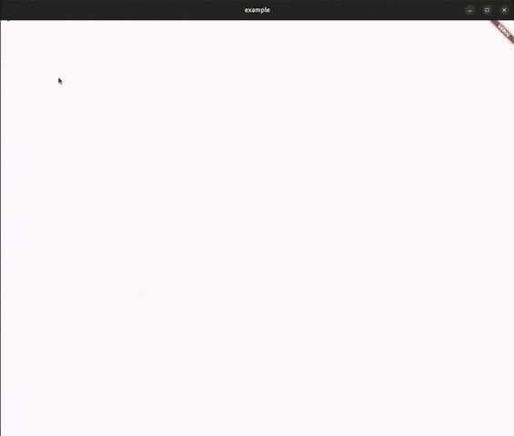
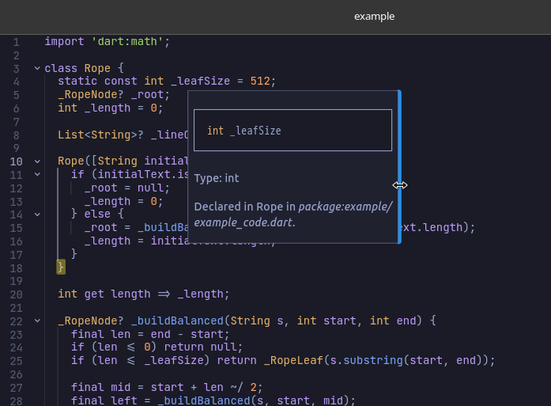

<p align="left">
  <a href="./README.md">English</a> |
  <a href="./README.zh-CN.md">简体中文</a> |
  <a href="./README.es.md">Español</a>
</p>

<h1 align="center">CodeForge</h1>

<p align="center">
  <strong>一款强大且功能丰富的代码编辑器组件。</strong>
</p>

<p align="center">
  <em>将 VS Code 级别的编辑体验带入你的 Flutter 应用</em>
</p>

<p align="center">
  <a href="https://pub.dev/packages/re_editor">re_editor</a>、<a href="https://pub.dev/packages/flutter_code_crafter">flutter_code_crafter</a>、<a href="https://pub.dev/packages/flutter_code_editor">flutter_code_editor</a>、<a href="https://pub.dev/packages/code_text_field">code_text_field</a> 等组件的更完整、更优秀的替代方案。
</p>

<p align="center">
  <a href="https://pub.dev/packages/code_forge">
    
  </a>
  <a href="https://github.com/heckmon/code_forge/blob/main/LICENSE">
    
  </a>
  <a href="https://github.com/heckmon/code_forge/stargazers">
    
  </a>
  <a href="https://flutter.dev">
    
  </a>
</p>

---

<p align="center">
  <sub><br>流畅编辑 100 万行以上代码，在一台数十年前配备奔腾双核 CPU、无独立显卡的低配 PC 上测试通过。</sub>
</p>
<p align="center">
  <sub><br>在 10 万行以上代码中实现基于 LSP 的智能按需高亮</sub>
</p>

### 功能演示：[CodeForge 功能展示](https://heckmon.github.io/code_forge_demo/)

> [!NOTE]
>
> 构建 Web 版本时，请使用 `--wasm` 参数以获得更好的性能。
> 例如：
>```
>flutter build web --wasm
>```

## 12.0.0 新特性：

### API 变更

为了降低复杂度，`CodeForge` 组件的相关参数现已归类到两个类中。

- 所有布尔开关都位于 `CodeForgeFeatures` 中，通过 `codeForgeFeatures` 参数传入。
- 所有样式选项都位于 `CodeForgeStyling` 中，通过 `codeForgeStyling` 参数传入。

```ts
// 示例：
CodeForge(
  codeForgeFeatures: const CodeForgeFeatures(
    autoFocus: true,
    lineWrap: false,
  ),
  codeForgeStyling: CodeForgeStyling(
    textStyle: GoogleFonts.jetBrainsMono(),
    bracketPairStyle: BracketPairStyle(
      style: PaintingStyle.fill,
      color: Colors.yellow.withAlpha(100),
    ),
    matchedWordStyle: const MatchedWordStyle(
      currentMatchStyle: TextStyle(backgroundColor: Color(0xFFFFA726)),
      otherMatchStyle: TextStyle(backgroundColor: Color(0x55FFFF00)),
    ),
  ),
)
```

旧顶层参数的迁移位置：

| 旧参数（顶层参数） | 新位置 |
|---------------------------|--------------|
| `readOnly`, `autoFocus`, `lineWrap`, `enableFolding`, `enableGutter`, `enableGuideLines`, `enableGutterDivider`, `enableKeyboardSuggestions`, `deleteFoldRangeOnDeletingFirstLine` | `codeForgeFeatures` |
| `textStyle`, `ghostTextStyle`, `selectionStyle`, `gutterStyle`, `suggestionStyle`, `hoverDetailsStyle`, `matchHighlightStyle`, `minimapStyle` | `codeForgeStyling` |

### 新增 API

- `backgroundOpacity`（0 - 255）可让编辑器背景呈半透明或完全透明。
- 可调整大小的悬停面板，可通过 `controller.hoverPanelWidth` 和 `controller.hoverPanelHeight` 读取或设置其尺寸。
  <p align="left">
    
  </p>
- 括号配对高亮（`CodeForgeFeatures.enableBracketPairMatching`、`BracketPairStyle`）。
- `CodeForge.plainTextField` 构造函数，可作为 `TextField` 的直接替代品，不含任何 IDE 功能。

### 修复

- 块级引号配对闭合问题。
- [#120](https://github.com/heckmon/code_forge/issues/120)

## 为什么选择 CodeForge？

**CodeForge** 是一款专为追求更高标准的开发者打造的新一代代码编辑器组件。无论你是在构建 IDE、代码片段查看器，还是编程教学平台，CodeForge 都能提供：

| 功能 | CodeForge | 其他组件 |
|---------|:---------:|:------:|
| 语法高亮 | 180+ 种语言<br>[支持的语言](https://github.com/reqable/re-highlight/tree/main/lib/languages) | 支持 |
| 代码折叠 | 智能检测 | 有限 |
| 多光标 | 无数量限制<br>（Alt + 单击） | 不支持 |
| LSP 集成 | 完整支持 | 不支持 |
| 缩进参考线 | 类似 VS Code 的参考线 | 不支持 |
| RTL 支持 | 支持阿拉伯语等从右到左的语言 | 不支持 |
| Git Diff UI | 显示新增与删除行 | 不支持 |
| AI 补全 | 支持幽灵文本（Ghost Text） | 不支持 |
| 诊断信息 | 行内错误提示 | 不支持 |
| 撤销/重做 | 智能分组 | 基础 |
| 完整主题定制 | [内置主题](https://github.com/reqable/re-highlight/tree/main/lib/styles) | 有限 |


### CodeForge 与其他编辑器的不同之处：
- 使用 Rope（绳索）数据结构而非普通字符数组来处理大文本。
- 使用 Flutter 底层的 `RenderBox` 和 `ParagraphBuilder` 渲染文本，而非基于 `TextField`，效率更高。
- 内置 [Language Server Protocol](https://microsoft.github.io/language-server-protocol/)（LSP）客户端。

---

如需查看 CodeForge 所有功能的实际运行示例（包括 AI 代码补全、LSP 集成、智能代码折叠、语法高亮、查找与替换以及 RTL 语言支持），请访问上方的高亮功能展示页面。

### 更多功能

<details>
<summary><strong>完整功能列表</strong></summary>

#### 编辑器核心
- **Rope 数据结构** - 针对大文件深度优化
- **180+ 种语言** - 基于 `re_highlight` 包提供
- **自定义语言与主题** - `CustomLanguageGrammar`（将 TextMate 语法转换为高亮模式）与 `CustomTheme`
- **代码折叠** - 智能代码块检测
- **缩进参考线** - 可视化代码结构
- **小地图（Minimap）** - 类似 VS Code 的编辑器实时缩略图
- **括号配对高亮** - 高亮显示匹配的括号
- **行号** - 支持当前行高亮，或通过 `GutterBuilder` 自定义行号栏内容
- **智能撤销/重做** - 基于时间戳的操作分组
- **查找与替换** - 查找栏、替换栏、匹配项高亮，以及通过 `finderBuilder` 自定义查找器
- **行操作** - 移动、复制、删除行
- **多光标** - 支持 Alt + 单击、Alt + Shift + 上/下方向键及控制器 API
- **自定义代码片段** - 在补全弹窗中显示你自己的代码片段
- **Git Diff 装饰** - 显示新增、修改以及虚拟删除的行
- **幽灵文本（Ghost Text）** - 行内 AI 风格代码建议
- **RTL 支持** - 文本方向及适配 RTL 的滚动体验
- **纯文本输入框模式** - `CodeForge.plainTextField`

#### LSP 功能
- **智能补全** - 上下文感知的代码建议及自动导入
- **悬停文档** - 位于可调尺寸面板中的富文本 Markdown 类型提示
- **实时诊断** - 错误与警告提示，支持快速修复
- **语义高亮** - 基于 Token 及修饰符的精准着色
- **签名帮助** - 函数签名与参数提示
- **代码操作（Code Actions）** - 快速修复与重构建议
- **内联提示（Inlay Hints）** - 类型与参数的行内标注
- **文档高亮** - 高亮符号在文档中的所有出现位置
- **文档颜色** - 颜色值检测与颜色选择器
- **跳转到定义** - 导航至符号定义处
- **符号重命名** - 跨工作区重命名符号
- **多协议支持** - 支持 Stdio 和 WebSocket
- **能力控制** - 按需启用或禁用单个 LSP 功能

#### 自定义能力
- **完整主题** - 每个视觉元素均可定制
- **行号栏样式** - 颜色、图标、尺寸
- **选区样式** - 光标、选区、光标气泡
- **弹窗样式** - 补全建议、悬停详情
- **滚动条样式** - 滚动条形状、颜色、行号指示器
- **小地图样式** - 宽度、颜色、字体大小、行高
- **键盘快捷键** - 通过 `CodeForgeKeyboardShortcuts` 重新映射大部分快捷键

</details>

---

## 安装

- 1 . 将 CodeForge 添加到你的 `pubspec.yaml` 中：

```yaml
dependencies:
  code_forge: ^12.0.0
```
- 2 . 然后运行：

```bash
flutter pub get
```

---

## 快速开始

### 基础用法

从 [re_highlight](https://pub.dev/packages/re_highlight) 包导入一个主题和一种语言即可开始使用。如果不传入，编辑器默认使用纯文本和 `lightfairTheme`：

```dart
import 'package:flutter/material.dart';
import 'package:code_forge/code_forge.dart';
import 'package:re_highlight/languages/python.dart';
import 'package:re_highlight/styles/atom-one-dark.dart';

void main() => runApp(const MyApp());

class MyApp extends StatelessWidget {
  const MyApp({super.key});

  @override
  Widget build(BuildContext context) {
    return MaterialApp(
      home: Scaffold(
        body: CodeForge(
          language: langPython, // 默认为纯文本
          editorTheme: atomOneDarkTheme, // 默认为 lightfairTheme
        ),
      ),
    );
  }
}
```

### 使用控制器

如需对编辑器进行更多控制：

```dart
class _EditorState extends State<Editor> {
  final _controller = CodeForgeController();
  final _undoController = UndoRedoController();

  @override
  void dispose() {
    _controller.dispose();
    super.dispose();
  }

  @override
  Widget build(BuildContext context) {
    return CodeForge(
      controller: _controller, // 可选控制器，用于解锁更多功能。
      undoController: _undoController, // 可选撤销控制器，用于控制撤销/重做操作。
      initialText: 'print("Hello, World!")', // 可选初始内容。
    );
  }
}
```

除了 `initialText`，你还可以通过 `filePath` 从本地文件加载内容，或通过 `fileUrl` 从 URL 加载内容。`fileUrl` 不能与 `initialText` 同时使用。

### 功能开关与样式

```dart
CodeForge(
  controller: _controller,
  language: langDart,
  editorTheme: atomOneDarkTheme,
  codeForgeFeatures: const CodeForgeFeatures(
    lineWrap: true,
    enableMinimap: false,
    useSpaceAsTab: true,
  ),
  codeForgeStyling: CodeForgeStyling(
    textStyle: const TextStyle(fontSize: 14, fontFamily: 'monospace'),
  ),
)
```

### 纯文本输入框

可将 `CodeForge.plainTextField` 用作功能更强大的 `TextField` 替代方案。它默认禁用行号栏、缩进参考线、代码折叠、小地图和括号配对高亮。

```dart
CodeForge.plainTextField(
  controller: _controller,
  initialText: 'Just some text',
)
```

---

### Web 构建

CodeForge 原生支持 Flutter Web 构建。由于 Web 应用无法访问本地文件系统路径，在浏览器中加载文档时请使用 `fileUrl` 替代 `filePath`：

```dart
CodeForge(
  fileUrl: '[https://example.com/files/main.dart](https://example.com/files/main.dart)',
  controller: controller,
)
```

`fileUrl` 是一个原始文件 URL，编辑器会自动拉取其内容。在 Web 构建中务必使用此参数，因为浏览器不支持 `filePath`。Web 端同样不支持 `controller.openFile`、`controller.saveFile()` 和 `controller.refetchFile()`。

如果启用了 LSP 功能，请同时通过 LSP 配置（或 `fileUri`）提供文档 URI，以便语言服务器识别虚拟文档。浏览器无法通过 stdio 启动 LSP 进程，请使用 `LspSocketConfig` 连接通过 WebSocket 暴露的 LSP 服务器：

```dart
final controller = CodeForgeController(
  lspConfig: LspSocketConfig(
    workspacePath: 'file:///workspace',
    languageId: 'dart',
    serverUrl: 'ws://localhost:9000',
  ),
);

CodeForge(
  controller: controller,
  fileUrl: '[https://raw.githubusercontent.com/heckmon/code_forge/main/lib/code_forge/controller.dart](https://raw.githubusercontent.com/heckmon/code_forge/main/lib/code_forge/controller.dart)',
)
```

WebSocket 服务器可使用 [`lsp-ws-proxy`](https://github.com/qualified/lsp-ws-proxy) 托管，例如：

```bash
./lsp-ws-proxy --listen 0.0.0.0:9000 -- dart language-server --protocol=lsp
```

<details>

<summary><h2>LSP 集成</h2></summary>

连接任意兼容 Language Server Protocol 的服务器，以获得智能代码辅助功能。

CodeForge 内置了 LSP 客户端，可连接到任意 LSP 服务器，实现智能高亮、代码补全、悬停详情、实时诊断等功能。

## 配置方式
#### 在 `CodeForge` 中配置 LSP 客户端有两种方式：
1. 使用 WebSocket（简单且推荐）
2. 使用 stdio

<details>
<summary><h3>1. 使用 WebSocket</h3></summary>

`LspSocketConfig` 类用于通过 WebSocket 连接 LSP 服务器。它接收以下参数：
- `serverUrl`：LSP 服务器的 WebSocket URL。
- `filePath`：LSP 服务器提供补全与诊断所需的文件路径。
- `workspacePath`：包含 `filePath` 文件的当前目录或父目录路径。
- `languageId`：与服务器相关的语言标识。例如：basedpyright/pyright 语言服务器使用的语言 ID 为 `'python'`。
- `enableDebugLogging`：默认关闭。开启后将在控制台打印 LSP 服务器输出。
- `capabilities`：可选的 [`LspClientCapabilities`](#lspclientcapabilities)，用于单独启用或禁用各项 LSP 功能。

你可以使用 [lsp-ws-proxy](https://github.com/qualified/lsp-ws-proxy) 轻松通过 WebSocket 启动任意语言服务器。例如，启动 basedpyright 语言服务器的命令如下：<br>
（在 Android 上可以使用 [Termux](https://github.com/termux/termux-app)）

```bash
cd /Downloads/lsp-ws-proxy_linux # 进入 lsp-ws-proxy 所在目录

./lsp-ws-proxy --listen 5656 -- basedpyright-langserver --stdio # 在 5656 端口启动 pyright 语言服务器
```

#### 示例：
创建一个 `LspSocketConfig` 对象并传给 `CodeForgeController`。

```dart
final lspConfig = LspSocketConfig(
  workspacePath: "/home/athul/Projects/lsp",
  languageId: "python",
  serverUrl: "ws://localhost:5656",
);
```
然后将 `lspConfig` 实例传给 `CodeForgeController`，再将控制器传给 `CodeForge` 组件：

```dart
final _controller = CodeForgeController(
  lspConfig: lspConfig, // 在此传入 LspConfig。
);

CodeForge(
  controller: _controller, // 在此传入控制器。
  editorTheme: anOldHopeTheme,
  filePath: "/home/athul/Projects/lsp/example.py",
)
```
</details>

<details>
<summary><h3>2. 使用 Stdio</h3></summary>

这种方式无需终端配置或额外工具即可直接启动，但在代码层面需要稍微多写一点初始化逻辑。`LspStdioConfig.start()` 方法通过 stdio 连接 LSP 服务器且为异步方法，因此通常需要配合 `FutureBuilder` 完成初始化。它接收以下参数：
- `executable`：LSP 服务器可执行文件的路径。
- `args`：传递给 LSP 服务器可执行文件的参数列表。
- `filePath`：LSP 服务器提供补全与诊断所需的文件路径。
- `workspacePath`：包含 `filePath` 文件的当前目录或父目录路径。
- `languageId`：与服务器相关的语言标识。例如：pyright 语言服务器使用的语言 ID 为 `'python'`。
- `enableDebugLogging`：默认关闭。开启后将在控制台打印 LSP 服务器输出。
- `capabilities`：可选的 [`LspClientCapabilities`](#lspclientcapabilities)，用于单独启用或禁用各项 LSP 功能。

可以在终端中使用 `which` 命令获取 `executable` 路径。例如，获取 `basedpyright-langserver` 的路径：

```bash
which basedpyright-langserver
```

#### 示例：
创建一个异步方法来初始化 LSP 配置。
```dart
Future<LspConfig?> _initLsp() async {
  try {
    final config = await LspStdioConfig.start(
      executable: '/home/athul/.nvm/versions/node/v20.19.2/bin/basedpyright-langserver',
      args: ['--stdio'],
      workspacePath: '/home/athul/Projects/lsp',
      languageId: 'python',
    );

    return config;
  } catch (e) {
    debugPrint('LSP Initialization failed: $e');
    return null;
  }
}
```
随后使用 `FutureBuilder` 初始化 LSP 配置并传给 `CodeForgeController`：
```dart
@override
Widget build(BuildContext context) {
  return MaterialApp(
    home: Scaffold(
      body: SafeArea(
        child: FutureBuilder(
          future: _initLsp(), // 调用异步方法获取 LSP 配置。
          builder: (context, snapshot) {
            if (snapshot.connectionState == ConnectionState.waiting) {
              return const Center(child: CircularProgressIndicator());
            }
            return CodeForge(
              editorTheme: anOldHopeTheme,
              controller: CodeForgeController(
                lspConfig: snapshot.data, // 在此传入配置。
              ),
              filePath: '/home/athul/Projects/lsp/example.py',
              codeForgeStyling: CodeForgeStyling(
                textStyle: const TextStyle(fontSize: 15, fontFamily: 'monospace'),
              ),
            );
          },
        ),
      ),
    ),
  );
}
```
</details>

<hr style="height: 1px; border: none; border-top: 1px">

### 使用 Stdio 的 Dart LSP 示例

```dart
Future<LspConfig> setupDartLsp() async {
  return await LspStdioConfig.start(
    executable: 'dart',
    args: ['language-server', '--protocol=lsp'],
    workspacePath: '/path/to/your/project',
    languageId: 'dart',
  );
}

// 在你的组件中
@override
Widget build(BuildContext context) {
  return MaterialApp(
    home: Scaffold(
      body: SafeArea(
        child: FutureBuilder<LspConfig>(
          future: setupDartLsp(),
          builder: (context, snapshot) {
            if (snapshot.connectionState == ConnectionState.waiting) {
              return const CircularProgressIndicator();
            }
            return CodeForge(
              language: langDart,
              codeForgeStyling: CodeForgeStyling(
                textStyle: GoogleFonts.jetBrainsMono(),
              ),
              controller: CodeForgeController(
                lspConfig: snapshot.data,
              ),
              filePath: '/path/to/your/file.dart', // 必填字段
            );
          },
        ),
      ),
    ),
  );
}
```
</details>

---

<details>
<summary><h2>自定义配置</h2></summary>

CodeForge 为编辑器的方方面面提供了丰富的自定义选项。所有布尔开关均放在 `CodeForgeFeatures` 中，所有样式配置均放在 `CodeForgeStyling` 中。

### 主题与样式

```dart
CodeForge(
  controller: controller,
  language: langDart,

  // 编辑器主题（语法配色）
  editorTheme: vs2015Theme,

  // 编辑器背景不透明度，范围 0 - 255
  backgroundOpacity: 255,

  codeForgeStyling: CodeForgeStyling(
    // 文本样式
    textStyle: GoogleFonts.jetBrainsMono(fontSize: 14),

    // 幽灵文本（行内 AI 补全建议）样式
    ghostTextStyle: const TextStyle(
      color: Colors.grey,
      fontStyle: FontStyle.italic,
    ),

    // 选区与光标
    selectionStyle: CodeSelectionStyle(
      cursorColor: Colors.white,
      selectionColor: Colors.blue.withValues(alpha: 0.3),
      cursorBubbleColor: Colors.blue,
    ),

    // 行号栏（行号与折叠图标）
    gutterStyle: GutterStyle(
      lineNumberStyle: const TextStyle(color: Colors.grey),
      backgroundColor: const Color(0xFF1E1E1E),
      activeLineNumberColor: Colors.white,
      foldedIconColor: Colors.grey,
      unfoldedIconColor: Colors.grey,
      errorLineNumberColor: Colors.red,
      warningLineNumberColor: Colors.orange,
    ),

    // 小地图
    minimapStyle: const MinimapStyle(
      width: 100,
      backgroundColor: Color(0xFF1E1E1E),
    ),

    // 补全建议弹窗
    suggestionStyle: SuggestionStyle(
      shape: RoundedRectangleBorder(borderRadius: BorderRadius.circular(8)),
      backgroundColor: const Color(0xFF252526),
      focusColor: Colors.blue.withValues(alpha: 0.3),
      hoverColor: Colors.blue.withValues(alpha: 0.1),
      splashColor: Colors.blue.withValues(alpha: 0.2),
      textStyle: const TextStyle(color: Colors.white),
      elevation: 8,
    ),

    // 悬停文档
    hoverDetailsStyle: HoverDetailsStyle(
      shape: RoundedRectangleBorder(borderRadius: BorderRadius.circular(8)),
      backgroundColor: const Color(0xFF252526),
      focusColor: Colors.blue.withValues(alpha: 0.3),
      hoverColor: Colors.blue.withValues(alpha: 0.1),
      splashColor: Colors.blue.withValues(alpha: 0.2),
      textStyle: const TextStyle(color: Colors.white),
    ),

    // 通过 controller.findWord() 和 controller.findRegex() 高亮匹配文本的样式
    matchedWordStyle: const MatchedWordStyle(
      currentMatchStyle: TextStyle(backgroundColor: Color(0xFFFFA726)),
      otherMatchStyle: TextStyle(backgroundColor: Color(0x55FFFF00)),
    ),

    // 选中括号配对的样式
    bracketPairStyle: BracketPairStyle(
      color: Colors.yellow.withAlpha(100),
      style: PaintingStyle.fill,
    ),
  ),

  // 滚动条需单独配置
  scrollbarDecoration: const ScrollbarDecoration(
    thickness: 15,
    showLineNumberIndicator: true,
  ),
)
```

### 自定义主题与语言

```dart
// 构建你自己的主题，无需局限于 re_highlight 内置主题
final myTheme = CustomTheme.create(
  color: Colors.white,
  backgroundColor: const Color(0xFF1E1E1E),
  keyword: const TextStyle(color: Colors.pinkAccent),
  string: const TextStyle(color: Colors.greenAccent),
  comment: const TextStyle(color: Colors.grey, fontStyle: FontStyle.italic),
);

// 将 TextMate 语法（JSON 字符串）转换为 re_highlight 的 Mode
final Mode myLanguage = CustomLanguageGrammar.fromJson(grammarJsonString);

CodeForge(
  editorTheme: myTheme,
  language: myLanguage,
)
```

### 功能开关

```dart
CodeForge(
  codeForgeFeatures: const CodeForgeFeatures(
    readOnly: false,                  // 只读模式
    autoFocus: true,                  // 挂载时自动聚焦
    lineWrap: false,                  // 自动换行
    enableMinimap: true,              // 小地图
    enableFolding: true,              // 代码折叠
    enableGuideLines: true,           // 缩进参考线
    enableBracketPairMatching: true,  // 高亮匹配括号
    enableGutter: true,               // 行号栏
    enableGutterDivider: false,       // 行号栏分隔线
    enableLocalSuggestions: true,     // 本地词汇补全。默认为 false。
    enableKeyboardSuggestions: true,  // 系统虚拟键盘建议
    useSpaceAsTab: false,             // 插入空格替代制表符
    deleteFoldRangeOnDeletingFirstLine: false,
  ),
)
```

### 自定义行号栏内容

`GutterBuilder` 接收从 1 开始的行号及该行文本。返回字符串即可替换该行的行号显示，返回 `null` 则保留默认行号。当 `includeReplacedIndex` 为 `false` 时，被替换的行不会计入后续行的编号。

```dart
CodeForge(
  gutterBuilder: GutterBuilder(
    includeReplacedIndex: false,
    builder: (lineNumber, lineText) => lineNumber == 1 ? '[HEADER]' : null,
  ),
)
```

### 自定义代码片段与右键菜单

```dart
CodeForge(
  // 输入时在补全弹窗中显示的代码片段。
  // cursorLocations 为 `value` 中的偏移量。主光标放置在第一个偏移量处，
  // 额外光标放置在其余偏移量处。
  customCodeSnippets: [
    CustomCodeSnippet(
      label: 'forloop',
      value: 'for (var i = 0; i < ; i++) {\n  \n}',
      cursorLocations: {20, 31},
    ),
  ],

  // 右键上下文菜单中的额外选项
  customContextMenuItems: [
    CustomContextMenu(
      label: 'Go to definition',
      description: 'F12',
      onPress: () => goToDefinition(),
    ),
  ],
)
```

### 键盘快捷键

只需覆盖你想修改的快捷键即可。核心操作（剪切、复制、粘贴、全选、撤销、重做）不可重新映射。将同一个快捷键绑定到多个操作会导致未定义行为。

```dart
// 将“复制行”从 Ctrl + D 改为 Ctrl + B
CodeForge(
  keyboardShotcuts: const CodeForgeKeyboardShortcuts(
    duplicate: SingleActivator(LogicalKeyboardKey.keyB, control: true),
  ),
)
```

请注意，当前 API 中该参数拼写为 `keyboardShotcuts`。

### 自定义 LSP 补全行

使用 `lspSuggestionBuilder` 替换每条 LSP 补全建议的默认内容。该构建器接收构建上下文、`LspCompletion` 项以及当前行是否处于选中状态。

```dart
CodeForge(
  lspSuggestionBuilder: (context, suggestion, isSelected) {
    return Row(
      children: [
        Icon(
          Icons.code,
          color: isSelected ? Colors.white : Colors.amber,
        ),
        const SizedBox(width: 8),
        Expanded(child: Text(suggestion.label)),
      ],
    );
  },
)
```

当该构建器为 `null` 时，CodeForge 会使用默认的 LSP 补全行以及 `pubspec.yaml` 中声明的内置类型图标字体。使用自定义内容时，编辑器仍会自动处理该行的选中、悬停、水波纹和点击交互。

### 自定义查找组件

`finderBuilder` 用于构建自定义搜索栏。返回的组件必须实现 `PreferredSizeWidget`。

```dart
CodeForge(
  findController: findController,
  finderBuilder: (context, findController) => MyFinderBar(findController),
)
```

</details>

---

<details>
<summary><h2>API 参考</h2></summary>

### CodeForge 组件

| 属性 | 类型 | 默认值 | 说明 |
|----------|------|---------|-------------|
| `controller` | `CodeForgeController?` | 内部创建 | 文本与选区控制器 |
| `undoController` | `UndoRedoController?` | 内部创建 | 撤销/重做历史控制器 |
| `findController` | `FindController?` | 内部创建 | 用于管理搜索功能的查找控制器 |
| `codeForgeFeatures` | `CodeForgeFeatures` | `CodeForgeFeatures()` | 所有布尔功能开关 |
| `codeForgeStyling` | `CodeForgeStyling` | `CodeForgeStyling()` | 所有样式配置 |
| `editorTheme` | `Map<String, TextStyle>?` | `lightfairTheme` | 语法高亮配色主题 |
| `language` | `Mode?` | 纯文本 | 语法高亮语言 |
| `extraLanguages` | `List<Mode>` | `[]` | 在同一高亮器中注册的额外语法，适用于嵌入了其他语言的场景（例如使用 XML/HTML 的 TSX） |
| `backgroundOpacity` | `int` | `255` | 编辑器背景不透明度，范围 0（全透明）至 255（不透明） |
| `filePath` | `String?` | `null` | 文件路径，用于加载文件及提供给 LSP。Web 端不可用 |
| `fileUri` | `String?` | `null` | 用于向 LSP 标识文件的文档 URI，包括 Web 虚拟文档 |
| `fileUrl` | `String?` | `null` | 用于加载编辑器内容的原始 URL。Web 端请用此参数替代 `filePath`。不能与 `initialText` 同时使用 |
| `initialText` | `String?` | `null` | 编辑器初始内容，仅在初始化时生效 |
| `focusNode` | `FocusNode?` | 内部创建 | 管理键盘焦点的焦点节点 |
| `innerPadding` | `EdgeInsets?` | `null` | 编辑器内容区域的内边距 |
| `verticalScrollController` | `ScrollController?` | 内部创建 | 自定义垂直滚动控制器 |
| `horizontalScrollController` | `ScrollController?` | 内部创建 | 自定义水平滚动控制器 |
| `verticalScrollPhysics` | `ScrollPhysics` | `ClampingScrollPhysics()` | 垂直滚动物理效果。由于编辑器内部使用专属的 RTL 感知物理效果，水平滚动物理效果不可更改 |
| `scrollbarDecoration` | `ScrollbarDecoration?` | `null` | 垂直滚动条的样式与行为 |
| `keyboardShotcuts` | `CodeForgeKeyboardShortcuts` | `CodeForgeKeyboardShortcuts()` | 键盘快捷键绑定 |
| `keyboardType` | `TextInputType` | `TextInputType.multiline` | 虚拟键盘类型 |
| `textDirection` | `TextDirection` | `TextDirection.ltr` | 文本方向。阿拉伯语、希伯来语等请使用 `TextDirection.rtl` |
| `tabSize` | `int?` | 制表符时为 `1`，开启 `useSpaceAsTab` 时为 `2` | 制表符宽度 |
| `customCodeSnippets` | `List<CustomCodeSnippet>?` | `null` | 显示在补全弹窗中的自定义代码片段 |
| `customContextMenuItems` | `List<CustomContextMenu>?` | `null` | 右键上下文菜单中的自定义项 |
| `gutterBuilder` | `GutterBuilder?` | `null` | 在行号栏中渲染自定义内容以替代默认行号 |
| `lspSuggestionBuilder` | `LspSuggestionBuilder?` | `null` | 为每条 LSP 补全行构建自定义内容（含自定义图标） |
| `finderBuilder` | `PreferredSizeWidget Function(BuildContext, FindController)?` | `null` | 自定义查找栏构建器 |

`CodeForge.plainTextField` 构造函数接收相同的参数，但其默认的 `codeForgeFeatures` 会关闭行号栏、缩进参考线、代码折叠、小地图和括号配对高亮。

### CodeForgeFeatures

| 开关 | 默认值 | 说明 |
|------|:-------:|-------------|
| `readOnly` | `false` | 禁止用户修改文本 |
| `autoFocus` | `false` | 挂载时自动获取焦点 |
| `lineWrap` | `false` | 超长行在编辑器边界处自动换行，而非水平滚动 |
| `enableMinimap` | `true` | 类似 VS Code 的编辑器实时缩略图 |
| `enableFolding` | `true` | 代码折叠，并在行号栏显示折叠图标 |
| `enableGuideLines` | `true` | 垂直缩进参考线 |
| `enableBracketPairMatching` | `true` | 光标位于括号旁时高亮显示配对括号 |
| `enableLocalSuggestions` | `false` | 本地非 LSP 词汇补全。因大文件下可能造成卡顿，默认关闭。LSP 补全通过 `LspClientCapabilities` 控制 |
| `enableKeyboardSuggestions` | `true` | 在系统虚拟键盘中显示自动补全建议 |
| `useSpaceAsTab` | `false` | 插入空格替代制表符 |
| `enableGutter` | `true` | 显示带有行号的行号栏 |
| `enableGutterDivider` | `false` | 在行号栏与编辑区之间显示分隔线 |
| `deleteFoldRangeOnDeletingFirstLine` | `false` | 删除已折叠代码块的首行时删除整个代码块 |

### CodeForgeStyling

| 属性 | 类型 | 说明 |
|----------|------|-------------|
| `textStyle` | `TextStyle?` | 编辑器内容的基础文本样式 |
| `ghostTextStyle` | `TextStyle?` | 幽灵文本（行内建议）的样式。默认采用降低透明度的基础文本样式 |
| `minimapStyle` | `MinimapStyle?` | 小地图样式 |
| `selectionStyle` | `CodeSelectionStyle?` | 光标与选区样式 |
| `gutterStyle` | `GutterStyle?` | 行号栏样式 |
| `suggestionStyle` | `SuggestionStyle?` | 补全建议弹窗样式 |
| `hoverDetailsStyle` | `HoverDetailsStyle?` | 悬停弹窗样式 |
| `matchedWordStyle` | `MatchedWordStyle?` | `findWord()` 和 `findRegex()` 匹配结果的样式 |
| `bracketPairStyle` | `BracketPairStyle?` | 括号配对高亮样式 |

### CodeForgeController

```dart
final controller = CodeForgeController(lspConfig: lspConfig); // lspConfig 为可选参数

// 文本与文档
controller.text = 'Hello, World!'; // 替换全部内容并将光标移至末尾
String content = controller.text;
int length = controller.length;
int lineCount = controller.lineCount;
String visible = controller.visibleText;          // 不含已折叠内容的可见文本
String line = controller.getLineText(0);
List<String> allLines = controller.lines;
List<String> lines = controller.getLinesRange(0, 10);
int lineIndex = controller.getLineAtOffset(42);
int lineStart = controller.getLineStartOffset(0);
int start = controller.findLineStart(42);
int end = controller.findLineEnd(42);
String lastChar = controller.lastTypedCharacter;
String prefix = controller.getCurrentWordPrefixAt(42);

// 编辑操作
controller.insertText('text', line, character);
controller.insertAtCurrentCursor('text', replaceTypedChar: false);
controller.replaceRange(start, end, 'replacement', preserveOldCursor: false);
controller.backspace();
controller.delete();
controller.duplicateLine();
controller.moveLineUp();
controller.moveLineDown();
controller.indent();
controller.unindent();
controller.readOnly = false;

// 缩进
controller.useSpaceAsTab = true;
controller.tabSize = 4;
String tab = controller.tabSpace;                 // 按下 Tab 键插入的字符串
int detected = controller.detectIndentation();
controller.reindentDocument(newTabSize: 2);

// 选区与剪贴板
controller.selection = const TextSelection(baseOffset: 0, extentOffset: 5);
TextSelection current = controller.selection;
controller.setSelectionSilently(TextSelection.collapsed(offset: 3)); // 不通知监听器
controller.setSelectionImmediately(TextSelection.collapsed(offset: 3));
controller.selectAll();
controller.copy();
controller.cut();
await controller.paste();

// 文件操作（Web 端不支持）
controller.openFile = '/path/to/file.dart';       // Setter
String? opened = controller.openedFile;
controller.saveFile();                            // 将 controller.text 写入当前打开的文件
controller.refetchFile();                         // 从磁盘重新加载当前打开的文件
// Web 文档请使用 controller.fileUri 和 controller.fileUrl

// 代码折叠
controller.foldAll();
controller.unfoldAll();
controller.toggleFold(lineNumber);                // 从 0 开始索引。若未启用折叠或无折叠范围将抛出 StateError
bool folded = controller.isLineInFoldedRegion(lineIndex);
int? foldStart = controller.getFoldStartForLine(lineIndex);
FoldRange? range = controller.getFoldRangeAtCurrentLine(lineIndex);
Map<int, FoldRange?> folds = controller.foldings; // 同样提供 setter
controller.deleteFoldRangeOnDeletingFirstLine = false;

// 滚动
controller.scrollToLine(50);                      // 从 0 开始索引。必要时自动展开折叠。越界将抛出 RangeError

// 查找与搜索
controller.findWord('word', matchCase: false, matchWholeWord: false);
controller.findRegex(RegExp(r'\d+'));
controller.clearSearchHighlights();
controller.searchHighlights; // List<SearchHighlight>，每项包含 start、end 和 isCurrentMatch

// 多光标
controller.addMultiCursor(line, character);
controller.clearMultiCursors();
controller.multiCursors;     // List<({int line, int character})>
controller.hasMultiCursors;
controller.moveMultiCursorsLeft(isShiftPressed: false);
controller.moveMultiCursorsRight(isShiftPressed: false);
controller.moveMultiCursorsUp(isShiftPressed: false);
controller.moveMultiCursorsDown(isShiftPressed: false);
controller.insertAtAllCursors('text');
controller.backspaceAtAllCursors();
controller.deleteAtAllCursors();

// 光标导航（均支持传入 isShiftPressed: false 以扩展选区）
controller.pressLetfArrowKey();   // 当前 API 中的方法名拼写如此
controller.pressRightArrowKey();
controller.pressUpArrowKey();
controller.pressDownArrowKey();
controller.pressHomeKey();
controller.pressEndKey();
controller.pressDocumentHomeKey();
controller.pressDocumentEndKey();

// 行装饰与行号栏装饰
controller.addLineDecoration(LineDecoration decoration);
controller.addLineDecorations(List<LineDecoration> decorations);
controller.removeLineDecoration('id');
controller.clearLineDecorations();
controller.addGutterDecoration(GutterDecoration decoration);
controller.addGutterDecorations(List<GutterDecoration> decorations);
controller.removeGutterDecoration('id');
controller.clearGutterDecorations();

// Git Diff 装饰
controller.setGitDiffDecorations(
  addedRanges: [(10, 15)],                                  // (startLine, endLine)
  modifiedRanges: [(20, 22)],
  removedRanges: [(afterLine: 29, content: 'final x = 10;\nfinal y = 20;')], // 虚拟展示，不占行号
  addedColor: const Color(0xFF4CAF50),
  removedColor: const Color(0xFFE53935),
  modifiedColor: const Color(0xFF2196F3),
);
controller.clearGitDiffDecorations();

// 幽灵文本（行内建议）
controller.setGhostText(GhostText(line: 10, column: 15, text: 'print("Hello");'));
controller.clearGhostText();

// 补全建议与 LSP
controller.lspConfig;                             // 构造函数传入的 LspConfig
controller.enableLocalSuggestions = true;
controller.showCompletions();                     // 在光标处请求补全（Ctrl + Space）
controller.acceptSuggestion(selectedIndex: 0);
controller.clearAllSuggestions();                 // 清除补全建议、签名帮助和代码操作
List<dynamic>? suggestions = controller.suggestions; // LSP 补全为 LspCompletion，本地补全为 String
List<LspErrors> diagnostics = controller.diagnostics;
await controller.callSignatureHelp();
controller.getCodeAction();
await controller.applyWorkspaceEdit(action);

// 内联提示（Inlay Hints）
await controller.showInlayHints();                // 拉取并显示提示。显示期间编辑器将变为只读状态
controller.hideInlayHints();
controller.setInlayHints(List<InlayHint> hints);
controller.clearInlayHints();
controller.inlayHints;

// 文档颜色与文档高亮
await controller.fetchDocumentColors();
controller.setDocumentColors(List<DocumentColor> colors);
controller.clearDocumentColors();
await controller.fetchDocumentHighlights(line, character);
controller.scheduleDocumentHighlightsRefresh(line, character); // 防抖版本
controller.clearDocumentHighlights();

// LSP 折叠范围
await controller.fetchLSPFoldRanges();
controller.clearLSPFoldRanges();

// 悬停面板尺寸
controller.hoverPanelWidth = 400;                 // 使用默认宽度时 getter 返回 null
controller.hoverPanelHeight = 300;

// 生命周期
controller.setUndoController(undoController);
controller.addListener(() {});
controller.removeListener(listener);
controller.dispose();
```

完整方法列表请参阅 [API 文档](https://pub.dev/documentation/code_forge/latest/code_forge_controller/CodeForgeController-class.html#instance-methods)。

### CodeForgeKeyboardShortcuts

每个字段均为 `ShortcutActivator`。默认值如下：

| 字段 | 默认快捷键 |
|-------|---------|
| `duplicate` | Ctrl + D |
| `shiftLineUp` | Ctrl + Shift + Up |
| `shiftLineDown` | Ctrl + Shift + Down |
| `deletWordBackward` | Ctrl + Backspace |
| `deletWordForward` | Ctrl + Delete |
| `moveCursorToPreviousWord` | Ctrl + Left |
| `moveCursorToNextWord` | Ctrl + Right |
| `moveSelectionToPreviousWord` | Ctrl + Shift + Left |
| `moveSelectionToNextWord` | Ctrl + Shift + Right |
| `moveSelectionBackward` | Shift + Left |
| `moveSelectionForward` | Shift + Right |
| `moveSelectionUpward` | Shift + Up |
| `moveSelectionDownward` | Shift + Down |
| `selectToLineStart` | Shift + Home |
| `selectToLineEnd` | Shift + End |
| `jumpToDocumentStart` | Ctrl + Home |
| `jumpToDocumentEnd` | Ctrl + End |
| `jumpToDocumentStartAndSelectText` | Ctrl + Shift + Home |
| `jumpToDocumentEndAndSelectText` | Ctrl + Shift + End |
| `lspCodeActions` | Ctrl + . |
| `lspSignatureHelp` | Ctrl + Shift + Space |
| `showCompletions` | Ctrl + Space |
| `showFindBar` | Ctrl + F |
| `showFindAndReplaceBar` | Ctrl + H |
| `extendMutliCursorDownward` | Alt + Shift + Down |
| `extendMutliCursorUpward` | Alt + Shift + Up |

LSP 内联提示快捷键（Ctrl + Alt）以及核心操作（剪切、复制、粘贴、全选、撤销、重做）不可修改。

### CodeSelectionStyle

```dart
CodeSelectionStyle({
  Color? cursorColor,
  Color selectionColor = const Color(0x6E2195F3),
  Color cursorBubbleColor = Colors.blue,
})
```

### GutterStyle

```dart
GutterStyle({
  TextStyle? lineNumberStyle,
  Color? backgroundColor,
  double? gutterWidth,
  IconData foldedIcon = Icons.chevron_right_outlined,
  IconData unfoldedIcon = Icons.keyboard_arrow_down_outlined,
  double? foldingIconSize,
  Color? foldedIconColor,
  Color? unfoldedIconColor,
  Color? activeLineNumberColor,
  Color? inactiveLineNumberColor,
  Color errorLineNumberColor = const Color(0xFFE53935),
  Color warningLineNumberColor = const Color(0xFFFFA726),
  Color? foldedLineHighlightColor,
})
```

### MinimapStyle

```dart
const MinimapStyle({
  double? width,
  Color? backgroundColor,
  Color? overlayColor,
  Color? overlayHoverColor,
  double? overlayBorderRadius,
  double fontSize = 2.5,
  double lineHeight = 3,
})
```

### SuggestionStyle 与 HoverDetailsStyle

两者均继承自 `OverlayStyle`。`shape`、`backgroundColor`、`focusColor`、`hoverColor`、`splashColor` 和 `textStyle` 为必填参数，`elevation` 默认为 `6`。

```dart
SuggestionStyle(
  shape: RoundedRectangleBorder(borderRadius: BorderRadius.circular(8)),
  backgroundColor: Colors.grey[900]!,
  focusColor: Colors.blue.withValues(alpha: 0.3),
  hoverColor: Colors.blue.withValues(alpha: 0.1),
  splashColor: Colors.blue.withValues(alpha: 0.2),
  textStyle: const TextStyle(color: Colors.white),
  // 可选参数，仅适用于 SuggestionStyle：
  selectedBackgroundColor: null,
  borderColor: null,
  borderWidth: null,
  itemHeight: null,
  iconSize: null,
  methodIconColor: null,
  propertyIconColor: null,
  classIconColor: null,
  variableIconColor: null,
  keywordIconColor: null,
  labelTextStyle: null,
  detailTextStyle: null,
  typeTextStyle: null,
)

HoverDetailsStyle(
  shape: RoundedRectangleBorder(borderRadius: BorderRadius.circular(8)),
  backgroundColor: Colors.grey[850]!,
  focusColor: Colors.blue.withValues(alpha: 0.3),
  hoverColor: Colors.blue.withValues(alpha: 0.1),
  splashColor: Colors.blue.withValues(alpha: 0.2),
  textStyle: const TextStyle(color: Colors.white),
)
```

### MatchedWordStyle 与 BracketPairStyle

```dart
const MatchedWordStyle(
  currentMatchStyle: TextStyle(backgroundColor: Color(0xFFFFA726)),
  otherMatchStyle: TextStyle(backgroundColor: Color(0x55FFFF00)),
)

BracketPairStyle(
  color: Colors.yellow.withAlpha(100), // 默认为文本颜色
  style: PaintingStyle.fill,           // fill（默认）或 stroke
)
```

### ScrollbarDecoration

用于配置垂直滚动条。

```dart
const ScrollbarDecoration({
  bool showLineNumberIndicator = true, // 在滚动条旁显示当前行号
  TextStyle? lineNumberStyle,
  Color? thumbColor,
  double? thickness,
  bool? thumbVisibility,
  BorderRadius borderRadius = BorderRadius.zero,
  double minThumbLength = 18.0,
  double? minOverscrollLength,
  bool? trackVisibility,
  Radius? trackRadius,
  Color? trackColor,
  Color? trackBorderColor,
  Duration fadeDuration = const Duration(milliseconds: 300),
  Duration timeToFade = const Duration(milliseconds: 600),
  Duration pressDuration = Duration.zero,
  ScrollNotificationPredicate notificationPredicate = defaultScrollNotificationPredicate,
  bool? interactive,
  ScrollbarOrientation? scrollbarOrientation,
  double mainAxisMargin = 0.0,
  double crossAxisMargin = 0.0,
  EdgeInsetsGeometry? padding,
})
```

### 装饰与浮层模型

```dart
// 行装饰：LineDecorationType 支持 background、leftBorder、underline 或 wavyUnderline
LineDecoration(
  id: 'bookmark-1',            // 必填且唯一
  startLine: 10,
  endLine: 15,
  type: LineDecorationType.background,
  color: Colors.green.withValues(alpha: 0.2),
  thickness: 3.0,
  priority: 0,
)

// 行号栏装饰：GutterDecorationType 支持 colorBar、icon 或 dot
GutterDecoration(
  id: 'breakpoint-1',          // 必填且唯一
  startLine: 25,
  endLine: 25,
  type: GutterDecorationType.icon,
  color: Colors.red,
  icon: Icons.circle,
  width: 3.0,
  tooltip: 'Breakpoint',
  priority: 0,
)

// 幽灵文本。默认在光标移动或输入不匹配字符时清除，按 Tab 或右方向键采纳。
// 设置 shouldPersist: true 后，仅能通过 clearGhostText() 移除
GhostText(line: 10, column: 15, text: 'print("Hello");', style: null, shouldPersist: false)

// 在真实代码行之间显示的已删除行，无行号
VirtualRemovedBlock(afterLine: 29, content: 'final x = 10;', backgroundColor: Color(0x30E53935))

// 内联提示、文档颜色与文档高亮（通常由 LSP 响应创建）
InlayHint(line: 3, column: 8, text: 'int', kind: InlayHintKind.type)
DocumentColor(line: 10, startColumn: 15, endColumn: 25, color: Color(0xFFFF0000))
DocumentHighlight(startLine: 4, startColumn: 2, endLine: 4, endColumn: 9)
```

所有行号和列号均从 0 开始索引。

### 其他类

```dart
FoldRange(startIndex, endIndex)                  // 可折叠区域的起止行（从 0 开始）
CustomContextMenu(label: '', description: '', onPress: () {})
GutterBuilder(builder: (lineNumber, lineText) => null, includeReplacedIndex: true)
DiagnosticLine(severity: ..., range: ..., message: ...) // 错误提示（波浪下划线），继承自 LspErrors
CustomTheme.create(color: ..., backgroundColor: ...)    // 返回 Map<String, TextStyle>
CustomLanguageGrammar.fromJson(String json)             // 返回 re_highlight 的 Mode
```

### LspClientCapabilities

控制在语言服务器初始化期间启用哪些 LSP 功能。

```dart
// 传给 LspSocketConfig 或 LspStdioConfig
final lspConfig = LspSocketConfig(
  workspacePath: "/path/to/workspace",
  languageId: "dart",
  serverUrl: "ws://localhost:5656",
  capabilities: LspClientCapabilities(
    semanticHighlighting: true,  // 语义 Token 高亮
    codeCompletion: true,        // 代码补全建议
    hoverInfo: true,             // 悬停文档
    codeAction: true,            // 代码操作与快速修复
    signatureHelp: true,         // 签名帮助
    documentColor: true,         // 文档颜色检测
    documentHighlight: true,     // 符号出现位置高亮
    codeFolding: true,           // 代码折叠范围
    inlayHint: true,             // 内联提示
    goToDefinition: true,        // 跳转到定义
    rename: true,                // 符号重命名
  ),
);
```

</details>

---
<details>
<summary><h2>键盘快捷键</h2></summary>
CodeForge 支持丰富的键盘快捷键以提升编辑效率。大多数快捷键均可通过 `CodeForgeKeyboardShortcuts` 重新映射。

### 编辑
- **Ctrl+C** - 复制选中文本。
- **Ctrl+X** - 剪切选中文本。
- **Ctrl+V** - 粘贴文本。
- **Ctrl+A** - 全选文本。
- **Ctrl+D** - 复制选中内容；若未选中，则复制当前行。
- **Ctrl+Z** - 撤销上一步操作。
- **Ctrl+Y** - 重做上一步操作。
- **Ctrl+Backspace** - 向后删除一个单词。
- **Ctrl+Delete** - 向前删除一个单词。
- **Alt + 单击** - 添加光标（多光标）。
- **Alt+Shift+上/下方向键** - 向上或向下扩展多光标。

### 导航
- **Ctrl+左方向键** - 将光标移至上一个单词。
- **Ctrl+右方向键** - 将光标移至下一个单词。
- **Ctrl+Home** - 将光标移至文档开头。
- **Ctrl+End** - 将光标移至文档末尾。
- **Ctrl+Shift+上方向键** - 将当前行上移。
- **Ctrl+Shift+下方向键** - 将当前行下移。

### 缩进
- **Tab** - 缩进当前行，或采纳 AI 补全/建议。
- **Shift+Tab** - 取消当前行缩进。

### 补全建议与 AI 补全
- **Ctrl+Space** - 手动触发补全建议。
- **Ctrl+.** - 显示可用的 LSP 代码操作。
- **Ctrl+Shift+Space** - 显示可用的 LSP 签名帮助。
- **Ctrl+Alt** - 显示 LSP 内联提示（不可重映射）。
- **上/下方向键** - 在补全建议中上下切换。
- **Enter/Tab** - 采纳当前建议。
- **Escape** - 关闭补全建议或悬停详情。

### 选择
- **Shift+方向键** - 扩展选区。
- **Ctrl+Shift+左/右方向键** - 选中至上一个/下一个单词。
- **Shift+Home** - 选中至行首。
- **Shift+End** - 选中至行尾。
- **Ctrl+Shift+Home** - 选中至文档开头。
- **Ctrl+Shift+End** - 选中至文档末尾。

### 搜索
- **Ctrl+F** - 打开查找栏。
- **Ctrl+H** - 打开替换栏。

</details>

---

## 谁在使用

- [Roxum IDE](https://github.com/heckmon/roxum-ide) - 一款极简且强大的 Android 端 IDE/代码编辑器。
- [Haha Note](https://github.com/catpuppyapp/HahaNote-Release) - 一款支持端到端加密同步的开源笔记应用。
- [Proxypin](https://github.com/wanghongenpin/proxypin) - 一款支持多平台的开源 HTTP(S) 抓包工具。

  ##### *想在这里展示你的应用？请在[此讨论区](https://github.com/heckmon/code_forge/discussions/categories/used-by)发帖提交你的应用详情。*
---

## 开源协议

本项目基于 MIT 协议开源，详情请参阅 [LICENSE](https://github.com/heckmon/code_forge/blob/main/LICENSE) 文件。

---

<p align="center">
  <strong>为 Flutter 社区倾情打造</strong>
</p>

<p align="center">
  <a href="https://github.com/heckmon/code_forge">
    
  </a>
</p>